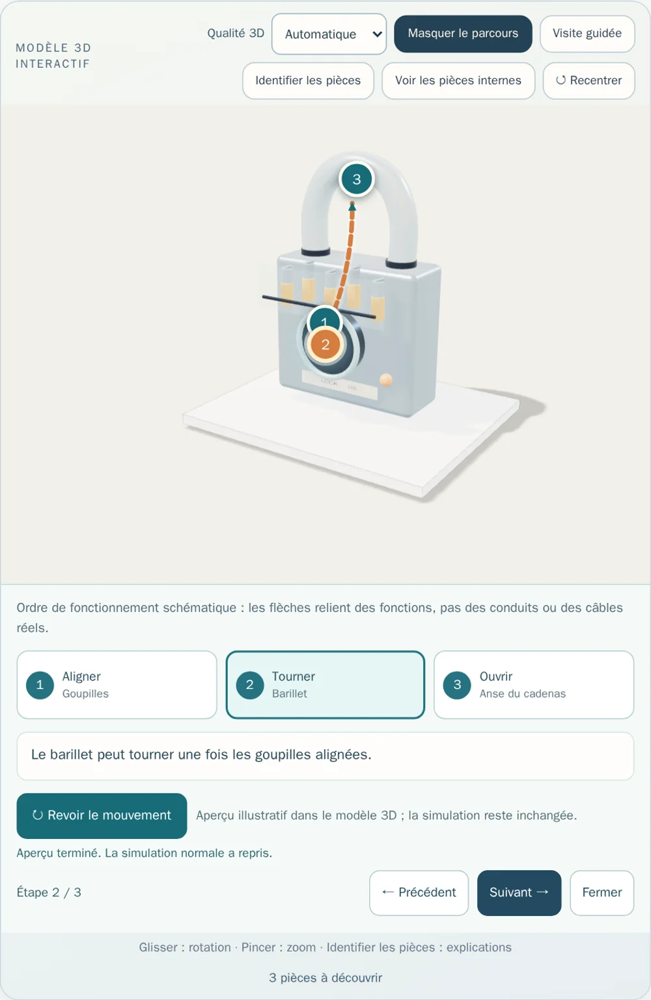

# Object Fonctionnement

Application Android éducative hors ligne.

## Interactive ColorFigures visualisations

The washing-machine and vending-machine pages at `public/figures/` are self-contained HTML built from the official ColorFigures archive, including the original engine and examples. They run offline inside an iframe with `sandbox="allow-scripts"` and do not need external requests. See `COLORFIGURES-LICENSE` (MIT, copyright April Zhu and Tolga Cohce). These are interactive educational models, not physical appliance emulators.

## Interactive ColorFigures visualisations

The washing-machine and vending-machine pages at `public/figures/` are self-contained HTML built from the official ColorFigures archive, including the original engine and examples. They run offline inside an iframe with `sandbox="allow-scripts"` and do not need external requests. See `COLORFIGURES-LICENSE` (MIT, copyright April Zhu and Tolga Cohce). These are interactive educational models, not physical appliance emulators.


## Interactions en 3D isométrique

Le catalogue comporte maintenant **9 objets**, tous avec une figure interactive :

| Objet | Interactions |
|---|---|
| Bouilloire | Remplissage, chauffe et arrêt thermique, versement, couvercle |
| Grille-pain | Insertion, niveau de brunissage, grillage et éjection |
| Ventilateur | Marche/arrêt, vitesse et oscillation |
| Serrure | Insertion de clé, alignement des goupilles, verrouillage |
| Pompe à vélo | Raccordement, coups de pompe, pression indicative |
| Cafetière filtre | Eau, filtre, extraction et service |
| Lampe | Interrupteur, intensité et compartiment piles |
| Lave-linge | Modèle original ColorFigures avec porte, tambour, tiroir et cycles |
| Distributeur | Modèle original ColorFigures avec monnaie, sélection et distribution |

Les **sept modèles nouveaux** sont définis dans `public/figures/objects.js` et
utilisent le moteur `public/figures/core.js`; les deux démonstrations
fournies avec ColorFigures sont intégrées sous forme HTML autonome.
Tous les scripts sont chargés localement, sans API ni pisteur.

**Licence tierce :** `COLORFIGURES-LICENSE` contient les crédits et
conditions MIT du moteur et des exemples. Les animations et vitesses
ne constituent **pas** des instructions de sécurité ni une réplique
exacte d'un modèle commercial; consulter les notices des fabricants.

## Tests et APK Android

```sh
npm install
npm run check
npm run build
npx cap add android
npx cap sync android
cd android && ./gradlew assembleDebug
```

GitHub Actions crée l'APK de débogage dans les artefacts du workflow.


### Générer de nouveaux aperçus

Les images du catalogue sont de vrais rendus ColorFigures, exportés au
format **WebP 480 × 360**, générés automatiquement depuis les modèles :

```sh
npm install
npx playwright install chromium
npm run generate:previews
```

La CI exécute également les tests Chromium à la largeur d'un écran Android :
vérification des interactions, du rendu SVG, des images et de la navigation.

```sh
npm run test:browser
```


## Confort et navigation Android

- Le bouton Retour physique revient à la liste lorsque la fiche d'un objet est ouverte.
- Depuis la liste principale, Retour minimise l'application au lieu de réouvrir
  une fiche depuis un historique artificiel.
- Les liens directs vers un objet et la navigation navigateur sont gérés
  sans dupliquer les entrées de l'historique.
- L'ajout ou le retrait d'un favori pendant la simulation ne redémarre pas le modèle.
- Les visualisations adaptent leur hauteur pour éviter un deuxième défilement
  à l'intérieur de la fiche sur Android.


## Recherche et accessibilité

La recherche accepte les mots sans accents et plusieurs termes
(par exemple cafe filtre ou bouilloire electrique). Les vues s'adaptent
aux smartphones étroits et aux tablettes. Les deux exemples originaux
ColorFigures disposent d'une traduction française de leurs contrôles.
L'application conserve la simulation active lorsqu'un favori est modifié.

GitHub Actions installe les dépendances à partir du fichier package-lock.json
via npm ci pour des builds reproductibles.


## Studio visuel et sonore (version 0.2)

- Palette enrichie, matériaux dessinés, halos de chaleur et de lumière,
  vapeur et filets d'air isométriques, écoulement et pulsations de pression.
- Les animations sont synchronisées avec les états des modèles :
  éjection progressive du grille-pain, rotation du barillet, variation du
  faisceau de la lampe, mouvement des pales, chauffe et extraction.
- Les bruitages sont générés localement par Web Audio : interrupteurs,
  moteurs, eau, vapeur, bulles, pièces, ressorts, pompe, serrure,
  gouttes et fin de cycle. Aucune bande-son tierce, aucun
  microphone ni pisteur.
- Le son est activé par défaut mais ne démarre qu'après une interaction.
  Il se coupe dans la page et dans l'application, avec préférence
  persistante entre les sessions.
- Ambiance sonore arrêtée lorsque le son est coupé ou la page fermée.
- Animations réduites si le système demande « réduire les animations ».
- Génération des neuf aperçus WebP dans la CI avant les tests.
- Moteur ColorFigures crédité sous licence MIT dans COLORFIGURES-LICENSE.

Les durées et sons sont stylisés, et non des reproductions exactes
d'appareils. Vérifier la qualité acoustique sur téléphone physique.


### Icône de l'application

L'identité visuelle comprend une icône originale (cube isométrique et
mécanisme central), fournie en SVG dans resources/app-icon.svg. La commande
npm run android:icons produit la favicon et les variantes PNG adaptées aux
densités Android, après la génération de la plateforme Capacitor.

La CI génère les icônes Android et renseigne versionCode 2 / versionName
0.2.0 pour cette évolution graphique et sonore.


## Version 0.3 — 3D en temps réel

Neuf scènes Three.js fonctionnent hors ligne avec de véritables
géométries, éclairages et matériaux PBR.

- Rotation tactile à un doigt et zoom à deux doigts.
- Recentrage caméra et vue technique translucide des pièces internes.
- Synchronisation des modèles 3D avec les commandes ColorFigures.
- Bascule 2D/3D sans perte des interactions et repli 2D si WebGL échoue.
- Mise au repos du GPU à l'arrêt, résolution plafonnée, libération des
  contextes graphiques lors des changements de fiche.
- Volume 0–100 % mémorisé et léger panoramique stéréo des bruitages.

Tous les sons sont synthétisés localement. Les géométries et matériaux
sont originaux. Aucun serveur, téléchargement de modèle ou pisteur.

Ces coupes et simulations sont pédagogiques, non des plans de démontage
ou d'entretien. Les performances et sons devront être contrôlés sur
plusieurs appareils Android physiques.

### Licences tierces

ColorFigures : MIT (COLORFIGURES-LICENSE).
Three.js : MIT (licenses/THREE-LICENSE), https://threejs.org/.

### Validation

npm ci, npm run check, npm run test:browser, npm run build,
npm run android:sync.

La CI génère l'APK Android de test 0.3.0, versionCode 3.


### Aperçus de la 3D temps réel


Pour régénérer ces captures via Chromium :

    npm run generate:3d-previews

Les rendus sont construits depuis les mêmes modèles Three.js que l'APK.


## Version 0.4 — inspection des mécanismes

Les neuf modèles 3D peuvent désormais être explorés directement avec le
bouton **Identifier les pièces**. Chaque objet propose trois composants
documentés (27 au total), dont les repères sont ancrés sur la géométrie.
Appuyer sur un repère affiche une explication en français et cadre la caméra
sur le composant. Les repères proches sont automatiquement espacés et reliés
à leur ancrage par un trait de rappel.

Utilisation : ouvrir un objet, afficher la 3D, choisir « Identifier les
pièces », sélectionner un numéro puis « Fermer » pour poursuivre
l'exploration. Le mode coupe/transparence demeure disponible. Les modèles
restent des simplifications pédagogiques, pas des instructions de réparation.

Améliorations techniques :
- Le canevas WebGL occupe désormais toute la largeur de son conteneur
  après l'ouverture d'une fiche (correction d'une ancienne largeur fixe).
- Les cibles tactiles des repères mesurent 44 × 44 px, et l'explication
  est accessible au clavier et avec un lecteur d'écran.
- Le cadrage animé respecte le réglage système de réduction des animations.
- Retour automatique à ColorFigures 2D lorsque le contexte WebGL est perdu.
- Libération des géométries, textures et matériaux créés par chaque scène.
- Tests automatisés des 27 positions, de la sélection des pièces, du
  chevauchement des repères, du redimensionnement et de la perte WebGL.

Capture réelle de la nouvelle fonctionnalité :


Pour régénérer les captures des objets et de l'inspection :
npm run generate:3d-previews.

GitHub Actions construit l'APK de test Android 0.4.0, versionCode 4.


## Version 0.5 — visites guidées hors ligne

Chaque modèle 3D propose désormais une visite structurée de ses trois
composants. Utiliser le bouton **Visite guidée**, puis **Précédent**,
**Suivant**, **Terminer la visite** ou **Quitter la visite**.

La caméra cadre successivement les mécanismes et une explication en
français accompagne chaque étape. La fiche d'explication est placée
sous le canevas : elle ne masque plus les mécanismes sur téléphone.
L'utilisateur reste libre de faire tourner le modèle, de zoomer et
d'actionner les commandes de simulation.

Seule l'action explicite **Terminer la visite** enregistre la visite
comme effectuée. Annuler n'enregistre rien. Le catalogue indique les
visites terminées et affiche un compteur sur les neuf objets. Ces
informations sont stockées localement dans l'application, sans
compte utilisateur ni synchronisation distante. Le progrès peut être
relu à une autre session et la visite reste rejouable.

Cette progression atteste seulement que les étapes ont été parcourues :
elle n'évalue ni les connaissances ni les capacités de réparation.


Les vérifications CI couvrent l'annulation, les trois étapes,
la navigation avant/arrière, la persistance et les tailles d'écran
320, 390 et 768 px.

La CI produit l'APK Android de test **0.5.0 (versionCode 5)**.


## Version 0.6 — Vérification des connaissances

Après avoir consulté un objet, l'utilisateur peut répondre à une question
sur le mécanisme ou sa fonction. Les neuf questions possèdent trois réponses
possibles et une explication pédagogique. Une réponse incorrecte ne compte
pas comme réussie, mais affiche la correction pour apprendre.

Les validations sont sauvegardées localement sur l'appareil, sans compte,
serveur, télémétrie ni connexion réseau. Le catalogue indique le nombre
de connaissances validées parmi les neuf objets. Les questions ne
réinitialisent pas les simulations 2D ou 3D en cours.

Les 9 fiches sont couvertes par les tests unitaires, et le scénario de
réponse incorrecte, réponse correcte et persistance par un test Chromium.
La CI prépare l'APK de test Android 0.6.0 (versionCode 6).


## Version 0.7 — révisions ciblées

Un bouton « À réviser » filtre les objets dont le quiz n'a pas encore
été réussi. Le compteur se met à jour à partir de la progression
existante, enregistrée uniquement dans le stockage local Android.
Ce filtre fonctionne avec les catégories et les favoris, sans modifier
les mécanismes ni effacer les progrès.

Pendant un quiz, une mauvaise réponse est indiquée sans révéler
immédiatement la réponse exacte. L'utilisateur peut réessayer.
Une bonne réponse explique le mécanisme puis verrouille la question
pour éviter les saisies répétées. Les résultats réussis sont conservés.

GitHub Actions construit l'APK Android 0.7.0 (versionCode 7).


## Version 0.8 — glossaire interactif

Le catalogue dispose d'un glossaire hors ligne qui indexe
automatiquement les composants de la vue 3D (27 fiches pour neuf objets).
Il ne duplique pas les explications : les descriptions proviennent directement
du fichier src/part-annotations.js, la source utilisée par les modèles.

- Recherche en français, sans distinction d'accents ou de casse.
- Recherche sur plusieurs mots, le composant, l'objet et l'explication.
- Depuis une fiche de glossaire, Voir en 3D ouvre le modèle concerné
  et cadre automatiquement la caméra sur le composant décrit.
- Le texte recherché est conservé pendant le retour au catalogue.
- Si WebGL est indisponible, la fiche de l'objet reste accessible en mode 2D.
- Tout le contenu fonctionne hors ligne, sans compte ni collecte de données.

Tests ajoutés : exhaustivité du glossaire, recherche multi-termes,
ouverture d'un composant et navigation retour.

La CI construit l'APK Android 0.8.0 (versionCode 8).


## Version 0.9 — moteur du ventilateur

Le modèle 3D du ventilateur bénéficie d'une hélice profilée à cinq pales,
disposées autour du même axe, ainsi que d'un moyeu distinct et d'une grille
de protection fixe. La rotation suit l'état réellement fourni par la
simulation ColorFigures ; la vitesse et l'oscillation restent contrôlées
par les commandes existantes. Les détails sont générés hors ligne par
Three.js, sans texture ni ressource tierce.

Des tests navigateur vérifient le mouvement sous tension et l'oscillation.
Un test de régression vérifie l'architecture de l'hélice et de la cage.

VersionCode Android 9, versionName 0.9.0.


## Version 0.10 — ventilateur 3D plus détaillé

Le ventilateur dispose désormais de deux grilles de protection distinctes,
avant et arrière, avec des cercles concentriques et quatre traverses
latérales. Leur parallaxe est visible lors de la rotation de la caméra.
Le rotor à cinq pales courbes continue de tourner indépendamment de
la cage. La base intègre un sélecteur de vitesse et trois voyants
dont l'état est synchronisé avec la simulation existante.

La géométrie reste entièrement procédurale et disponible hors ligne.
Les tests de catalogue, d'interaction et de rendu 3D restent actifs.
La CI construit l'APK Android 0.10.0 (versionCode 10).


## Version 0.11 — trois appareils 3D améliorés

Cette version approfondit les visualisations procédurales sans ajouter
de ressources distantes :

- **Bouilloire :** jauge d'eau graduée nettement visible sur la face avant,
  niveau lié aux actions, couvercle sur charnière qui s'ouvre
  progressivement, anneau chauffant et vapeur.
- **Grille-pain :** deux chambres avec résistances visibles et protections,
  tranches arrondies avec croûte et mie qui brunissent selon la cuisson,
  chariot à levier et éjection synchronisés.
- **Cafetière filtre :** réservoir transparent déplacé sur la face visible,
  eau à niveau variable, filtre avec café moulu, gouttes d'eau chaude,
  verseuse qui se remplit et vapeur stylisée.
- **Animations :** correction du passage du temps absolu au moteur pour
  la bouilloire, la cafetière, le lave-linge et le distributeur.
  Le couvercle continue son interpolation jusqu'à sa position finale.
- **Tests visuels :** Playwright et Sharp comparent les images réelles du
  WebGL avant et après une action sur les trois appareils. Le mouvement
  du couvercle est également vérifié.

Captures générées depuis les modèles réels :


Ces modèles restent des schémas pédagogiques stylisés, et non des
reconstitutions industrielles exactes. Les sons existants demeurent
générés localement, sans piste audio téléchargée.

GitHub Actions produit l'APK Android de test 0.11.0 (versionCode 11).


## Version 0.12 — pompe à vélo : cinématique du piston

Le modèle 3D de la pompe à vélo présente désormais une tige de piston
reliée au déplacement de la poignée. Un joint, des repose-pieds,
un raccord de valve et un témoin de pression enrichissent la mécanique
visible. L'aiguille du manomètre reste synchronisée avec la pression
de la simulation ColorFigures existante. Aucun téléchargement ni
permission Android supplémentaire n'est nécessaire.

Tests : 25 vérifications unitaires, tous les scénarios navigateur
et les neuf modèles 3D. APK de test Android 0.12.0 (versionCode 12).


## Version 0.13 — mécanismes 3D du cadenas, lave-linge et distributeur

Cette version améliore les trois objets dont les mécanismes étaient
insuffisamment représentés dans la visualisation 3D.

- **Serrure** : cinq goupilles et leurs ressorts visibles dans une
  fenêtre translucide ; barillet et clé pivotant sur le même axe,
  anse du cadenas animée lors du déverrouillage.
- **Lave-linge** : tambour indépendant de la porte articulée, linge
  représenté à l'intérieur du tambour, remplissage et vidange visibles,
  indicateurs des phases de cycle, sélecteur et tiroir à lessive.
  Les phases suivent les mêmes durées que la simulation ColorFigures.
- **Distributeur** : meuble réellement creux, 4 × 4 emplacements avec
  jusqu'à trois produits en profondeur, stock et crédit visibles,
  produit animé de l'étagère vers le bac, trappe articulée et pièces rendues.
- **Son** : les bruitages du lave-linge distinguent l'arrivée d'eau,
  le lavage, la vidange et l'essorage ; le moteur se tait pendant la
  pause. Tous les sons restent synthétisés sur l'appareil.
- **Communication** : l'état imbriqué des stocks, de la chute et du
  bac du distributeur est transmis par messages locaux limités aux
  champs nécessaires, sans service externe ni permission supplémentaire.

Le mode illustrations 2D, la navigation, le glossaire, les leçons 3D,
la progression et les quiz sont conservés. Les représentations restent
des modèles pédagogiques et non des plans de réparation.

### Nouveaux aperçus Three.js


Captures créées par npm run generate:3d-previews. La CI construit
l'APK Android de test 0.13.0 avec versionCode 13.


## Version 0.14 — optique de la lampe torche

Le modèle 3D de la lampe torche possède désormais un réflecteur
métallique, trois anneaux concentriques de lentille, une bague de
protection, un bouchon arrière et un bouton qui s'enfonce à
l'allumage. La source lumineuse et le faisceau restent pilotés par
la simulation d'origine. Tous les éléments sont procéduraux,
sans téléchargement supplémentaire.

28 tests unitaires et les scénarios navigateur passent.
La CI produit l'APK Android 0.14.0 (versionCode 14).


## Version 0.15 — qualité graphique 3D adaptée à Android

Chaque fiche d'objet propose désormais trois qualités graphiques sélectionnables
sans interrompre la simulation ni perdre les progrès :

- Automatique (par défaut) : densité de pixels limitée à 1,2 sur les écrans
  compacts, 1,5 sur les plus grands, et ombres en 512 ou 1024 points.
- Économie : densité de pixels de 1, ombres en 256 points et cadence
  d'animation plafonnée à environ 20 images/seconde pour réduire la charge GPU.
- Haute qualité : densité de pixels jusqu'à 2, ombres en 1024 points et
  cadence d'animation d'environ 30 images/seconde.

Le choix est conservé dans le stockage local, appliqué aux neuf modèles 3D,
et modifiable instantanément sur une fiche. Les rendus statiques continuent
de mettre le GPU en veille, conformément à la version précédente. Le réglage
Automatique respecte les préférences de réduction des animations du système.

Tests : validations des profils, stockage résilient et tests navigateur réels
de changement de résolution, de persistance et de veille GPU. GitHub Actions
construit l'APK Android 0.15.0 (versionCode 15).

Les modèles restent des schémas pédagogiques ; ce réglage améliore leur
netteté et leur coût GPU, pas leur précision mécanique.


## Version 0.16 — matériaux procéduraux et repères 3D

Les neuf modèles 3D utilisent désormais des microtextures déterministes,
générées localement (128 × 128), pour différencier l'acier brossé, les
plastiques moulés et les surfaces caoutchoutées. Les cartes de rugosité
et de léger relief sont partagées entre les modèles ; aucune connexion
internet ni nouvelle ressource distante n'est requise.

Lors de l'inspection d'une pièce ou d'une visite guidée, un repère
lumineux 3D indique sa position réelle dans le modèle. Il disparaît
à la fermeture de l'explication, à la fin de la visite ou lorsque les
repères sont masqués. Cet effet est statique : il ne demande pas de
boucle d'animation supplémentaire sur Android.

Les profils de qualité graphique Automatique, Économie et Haute
qualité restent disponibles ; le moteur conserve la mise en veille
des rendus statiques et le repli 2D.

Tests : 32 contrôles unitaires, contrôles déterministes des textures,
tests navigateur des neuf objets et cycle de vie des repères de pièces.
GitHub Actions construit l'APK Android 0.16.0 (versionCode 16).


## Version 0.17 — visualisation 3D du flux d'air

Le ventilateur 3D propose maintenant « Visualiser le flux d'air ».
Quand le moteur fonctionne, un ensemble de petites particules
se déplace depuis la grille avant vers l'extérieur et suit
l'oscillation de la tête. Les particules disparaissent lorsque le
moteur est arrêté ou lorsque le réglage est désactivé.
Cette représentation schématique explique le principe des
pales inclinées : il ne s'agit pas d'une mesure aérodynamique.

L'effet est réalisé par un seul InstancedMesh Three.js
(pas 64 objets avec 64 appels GPU). Le nombre de particules
dépend du profil graphique Android : 24 en Économie, 40 en
Automatique et 64 en Haute qualité. Le calcul est déterministe,
hors ligne, et la préférence d'affichage est conservée localement.
En dehors du ventilateur, l'interface ne présente pas ce réglage.


Les tests vérifient les positions des particules, leur mouvement
et leur adaptation à la vitesse, le changement visuel réel en
Chromium, la persistance, et l'interface à 320 px. Les neuf
modèles 3D et les interactions précédentes continuent d'être testés.

Version Android 0.17.0, versionCode 17, APK de test
généré par GitHub Actions.


## Version 0.18 — tambour de lave-linge et tiroir à lessive

Le lave-linge 3D possède désormais un tambour avec 96 perforations
concentriques dessinées par une seule instance GPU (InstancedMesh).
Trois aubes de brassage sont solidaires du tambour et suivent sa
rotation pendant les phases de lavage et d'essorage. Le tiroir
à lessive comporte deux compartiments séparés, visibles lors de
son ouverture. La simulation, les niveaux d'eau et la gestion des
cycles existants sont conservés.

Les détails sont procéduraux et hors ligne. Les profils de qualité
graphique et le rendu à la demande restent actifs pour les appareils
Android modestes.

34 tests unitaires et tous les scénarios navigateur passent.
La CI produit l'APK Android 0.18.0 (versionCode 18).


## Version 0.19 — distribution mécanique et extraction du café

Le distributeur 3D respecte les **16 références de la simulation ColorFigures** :
les rangées A et B vendent des canettes, C des bouteilles, et D des sachets.
Les couleurs de chaque emplacement reproduisent les couleurs d'origine.
Les 48 unités en stock, le produit qui tombe et le produit récupéré
dans le bac partagent désormais la forme et la couleur de leur référence.

Chaque colonne dispose d'une **spirale électromécanique**. Les 16 spirales
sont rendues par une unique géométrie instanciée ; seule celle de la
référence sélectionnée pivote d'un tour pendant la distribution. Les
quantités en stock, le crédit, la chute et le volet restent synchronisés
avec la simulation originale. Les objets instanciés libèrent explicitement
leurs buffers GPU lors du changement de modèle.

La cafetière 3D comporte maintenant des nervures métalliques sur le
porte-filtre, une plaque chauffante dont la lumière réagit à l'extraction,
et deux ondulations suivant le niveau réel de café dans la verseuse.
Les nouveaux éléments sont entièrement procéduraux et hors ligne.

Tests : 37 tests unitaires (incluant les références, couleurs et limites
des 16 sélections) ; tests navigateur des neuf modèles, de la vue 3D,
et différences visuelles des produits B3, C2, D4 dans le bac. Profils de
qualité graphique et repli 2D conservés. APK Android 0.19.0 (versionCode 19).


## Version 0.20 — distribution en trois phases et bruitages synchronisés

Le distributeur pédagogique présente désormais la transaction en cours
sur son écran 3D, avec le code A1–D4 de l'article sélectionné, la
progression de la distribution et l'indication de récupération. Les
montants restent calculés par la simulation ColorFigures d'origine.

L'animation de chute est organisée en trois étapes temporelles continues :
libération de la spirale, descente accélérée vers le bac, puis réception
avec un léger rebond. Ces mouvements sont pilotés exclusivement par
drop.r, drop.c et drop.t (sans achat artificiel ni état divergent).
Le code est isolé dans des fonctions pures testables.

Le moteur de bruitages local Web Audio distingue désormais la mise en
route de la spirale, la réception dans le bac et l'enlèvement du produit.
Il produit également un bruit d'arrivée d'eau au démarrage du café.
Tous ces sons respectent l'activation par un geste, le volume utilisateur,
la coupure du son et l'arrêt hors premier plan. Aucun fichier audio ou
service externe n'est ajouté.

Validation : 39 tests unitaires, scénarios Chromium complets, y compris
les transitions audio et les neuf objets 3D. Les trois profils graphiques,
le rendu GPU à la demande et la vue de secours 2D restent disponibles.
La CI GitHub produit l'APK Android de test 0.20.0 (versionCode 20).


## Version 0.21 — circulation de l'eau dans la cafetière

La cafetière 3D possède maintenant un circuit transparent externe, du
réservoir jusqu'à la douche d'extraction, avec six gouttelettes animées.
Ce flux apparaît seulement lorsque l'extraction est active et que le
réservoir contient de l'eau. Le niveau de la verseuse, la plaque
chauffante et les gouttes de café restent synchronisés avec la
simulation d'origine. Aucun accès réseau ni ressource nouvelle.

39 tests unitaires et les scénarios navigateur passent. La CI
construit l'APK Android 0.21.0 (versionCode 21).


## Version 0.22 — parcours du mécanisme en trois étapes

Chaque objet dispose désormais d'un mode **Comprendre le mécanisme**,
distinct des 27 fiches du glossaire et des visites guidées existantes.
Les neuf parcours (27 étapes au total) présentent dans leur ordre les
principales fonctions de l'objet. L'utilisateur choisit une étape ou
utilise les boutons Précédent et Suivant pour parcourir les explications
avec recentrage de la caméra et repère lumineux.

Deux flèches SVG relient les trois composants ancrés sur les vrais modèles
3D et suivent la rotation/zoom de la caméra. Il s'agit de liens causaux
**schématiques**, pas de conduites, câblages ou chemins physiques réels.
Le mode évite de superposer les repères de la visite guidée aux flèches,
et se ferme automatiquement si l'on passe à une visite guidée,
à l'inspection des composants, ou au recentrage de la caméra.

L'interface fonctionne hors ligne, comprend de grandes cibles tactiles
sur Android, respecte le mode d'animation réduite et n'ajoute aucune
boucle de rendu GPU permanente. Le mode 2D de secours est inchangé.

Captures réelles :
- [Parcours de la cafetière](docs/previews/coffee-mechanism-flow.webp)
- [Parcours du distributeur](docs/previews/vending-mechanism-flow.webp)

Tests : 42 tests unitaires, scénarios Chromium sur les neuf modèles,
navigation entre les trois étapes, retour aux visites guidées,
réinitialisation et ergonomie Android 320/390/768 px.
L'APK Android 0.22.0 est construit en CI avec versionCode 22.


## Version 0.24 — lisibilité du parcours pédagogique sur Android

Sur les neuf modèles 3D, le parcours « Comprendre le mécanisme » a des
repères numérotés bornés à la taille réelle de la zone WebGL. Les
flèches de causalité sont tracées uniquement si deux étapes projetées
sont suffisamment éloignées pour qu'une flèche puisse réellement passer
entre les disques. Les liens trop courts sont masqués plutôt que de
traverser les numéros ou former des courbes inversées.

Cette amélioration est calculée à partir de la projection existante :
aucun dessin supplémentaire, aucune connexion réseau, et aucune boucle
d'animation permanente. Le focus caméra, la navigation au clavier et
les visites guidées de la v0.23 restent compatibles.

44 tests unitaires, dont les projections et les segments d'étapes, et
tous les scénarios de navigateur réussis. Android versionCode 24.


## Version 0.25 — correction des visites guidées et déblocage APK

Restauration de l'indicateur de progression natif des visites 3D dans les
neuf modèles. Il reflète les trois étapes en cours et expose explicitement
les attributs aria-valuenow, aria-valuemin et aria-valuemax. Une jauge
contrastée facilite la lecture sur smartphone.

Cette modification corrige également le test de navigateur bloquant la
compilation GitHub Actions 0.24. Les scénarios Chromium et 44 tests
unitaires passent localement. Android versionCode 25.


## Version 0.26 — prévisualiser le mouvement au fil de l'explication

Le parcours « Comprendre le mécanisme » dispose maintenant d'un bouton
**Voir le mouvement** pour 23 étapes sur les 27 disponibles. Les étapes
sans mouvement effectivement représenté dans le modèle affichent
« Mouvement non modélisé », afin de ne pas inventer des fonctions.

Chaque aperçu anime uniquement le modèle 3D associé à l'étape choisie
(rotation, chauffe, ouverture, piston, écoulement, distribution, etc.).
Il dure environ 2,1 secondes, ou 0,9 seconde avec la réduction des
animations activée dans les préférences du système. Les changements
d'étape, la fermeture du parcours et la navigation interrompent
l'aperçu immédiatement. Les valeurs du simulateur ColorFigures isolé
ne sont jamais modifiées et sont restaurées visuellement à la fin.

Le bouton affiche la progression en direct et autorise le rejeu.
Les calculs sont déterministes et ne téléchargent aucune ressource.
Une preuve visuelle est disponible :



Tests : 47 tests unitaires, scénario Chromium des neuf objets, des
aperçus temporaires, des étapes indisponibles et de l'absence de
modification de la simulation originale ; capture d'écran différentielle
confirmant le mouvement du barillet. Android versionCode 26.


## Version 0.27 — arrêt immédiat des animations pédagogiques

Pendant l'aperçu d'un mouvement, le bouton « Arrêter le mouvement »
reste accessible. Il annule immédiatement la démonstration, restaure
l'état réel du modèle 3D et permet de relancer le même mouvement.
Changer d'étape annule aussi l'aperçu. Les commandes de la simulation
ColorFigures restent inchangées.

Un scénario Chromium vérifie l'arrêt, la restauration de la scène,
la reprise et la navigation. 47 tests unitaires et les scénarios
navigateur réussissent. Android versionCode 27.


## Version 0.28 — examen image par image des mouvements 3D

Les 23 mouvements illustratifs des neuf objets disposent désormais
d'un contrôle **Examiner image par image** (0–100 %). L'utilisateur
peut positionner le mécanisme à n'importe quel instant, figer l'image,
puis reprendre la lecture depuis cette position ou rétablir immédiatement
la simulation normale. La jauge se synchronise pendant la lecture et
se remet à zéro à la fin.

Les étapes dont les mouvements ne sont pas modélisés ne présentent
pas de curseur artificiel. La démonstration reste isolée de l'iframe
ColorFigures : aucun état, stock, crédit, progression ou action de la
simulation réelle n'est altéré.

En mode image figée, la vue 3D ne programme pas de boucle de rendu
continue : le processeur graphique se met en veille jusqu'à une autre
interaction. Les commandes sont accessibles sur Android (cibles tactiles
de 44 px) et fonctionnent hors ligne.

Capture réelle de la fonctionnalité (vue Android 390 px) :
[Inspection du barillet à 72 %](docs/previews/lock-motion-scrub.webp).

Tests : 47 tests unitaires ; scénarios Chromium incluant le
positionnement 10/85 %, l'absence de mouvement au repos, la reprise
depuis une position choisie, le retour au mode normal, l'absence de
modification de la simulation et les étapes non représentées.
GitHub Actions produit l'APK Android 0.28.0 (versionCode 28).


## Version 0.29 — étapes tactiles et coupe pédagogique 3D

Les trois repères du parcours « Comprendre le mécanisme » se touchent
désormais directement dans le modèle 3D : une cible transparente de 48 px
entoure chaque numéro, tandis que la vue reste libre à la rotation en
dehors de ces points. Le toucher sélectionne la même étape, explication
et position de caméra que les boutons sous le modèle. La liste du parcours
reste accessible au clavier et aux lecteurs d'écran.

Le panneau pédagogique propose une **coupe technique** pour révéler les
pièces internes pendant l'explication et les mouvements illustratifs.
Cette option est synchronisée avec la commande déjà existante « Voir les
pièces internes » : pas d'état contradictoire ni de réinitialisation
forcée des préférences pendant la visite.

La suite de tests navigateur vérifie un vrai clic sur un repère projeté,
la sélection de l'étape et la synchronisation des deux commandes de
coupe. Toutes les autres démonstrations hors ligne sont conservées.
47 tests unitaires et scénarios Chromium validés localement.
APK Android 0.29.0 / versionCode 29.


## Version 0.30 — repères 3D pilotables au clavier

Les trois repères du parcours « Comprendre le mécanisme » deviennent
accessibles au clavier (Entrée / Espace) et exposent le nom de leur étape
ainsi que l'étape active aux technologies d'assistance. Les gestes tactiles
48px et la rotation libre de la caméra sont conservés. Le parcours ne
modifie jamais l'état des simulations originales. Tests Chromium ajoutés
pour les deux touches et la synchronisation des repères.

Android versionCode 30.


## Version 0.31 — clapet antiretour de la pompe à vélo

La pompe possède une chambre de clapet **transparente** réellement visible
dans le modèle 3D, comprenant siège, bille métallique et ressort comprimable.
Sur une descente de piston, la bille se soulève et de petites particules
suivent le tuyau vers la valve du pneu. Le retour du piston referme le
clapet ; l'arrêt de la pompe restaure la position fermée sans boucle GPU
permanente.

La deuxième étape de la leçon (« Retenir ») devient une démonstration 3D
consultable image par image. Elle ne modifie jamais l'état réel des
interactions SVG. La simulation 2D et la représentation 3D emploient
désormais le même sens physique de descente du piston.

24 démonstrations mécaniques disponibles. Le vérificateur couvre le
sens du clapet, la sécurité de fermeture, les états de démonstration
et le rendu différencié ouvert/fermé en Chromium.

Captures réelles de la nouvelle version :
[Pompe 3D](docs/previews/bicycle.webp) ·
[Clapet antiretour pendant la leçon](docs/previews/bicycle-valve-lesson.webp).

Android versionCode 31.


## Version 0.32 — circuit hydraulique et lessive du lave-linge

La vue 3D de la machine à laver représente les trajets d'eau et de
lessive depuis le tiroir jusqu'au tambour, et celui de l'eau évacuée
vers la vidange. Les conduites transparentes sont **schématiques**,
et non le plan technique exact d'un appareil commercial. Les
gouttelettes bleues, les grains ambrés de lessive et le flux de vidange
sont rendus en **trois lots InstancedMesh** pour limiter les appels GPU.

Les états suivent directement les phases du programme ColorFigures :
- remplissage : eau entrante, lessive si une dose a été ajoutée ;
- vidange : eau sortante jusqu'à la fin de l'évacuation ;
- arrêt, pause ou essorage à sec : aucun flux en mouvement.

La deuxième étape de « Comprendre le mécanisme » illustre la fermeture
du tiroir, puis le passage de l'eau et de la lessive sans démarrer
ni modifier réellement la simulation. La position des particules
lors de l'exploration image par image est déterministe.

La capture [Leçon hydraulique du lave-linge](docs/previews/washer-hydraulics-lesson.webp)
a été réalisée directement dans le modèle 3D, en format téléphone.

53 tests unitaires et les tests navigateur Chromium sont passés.
Android versionCode 32.


## Version 0.33 — chariot mécanique du grille-pain

Le modèle 3D du grille-pain comporte désormais un chariot mobile
commun aux deux tranches, deux glissières, un ressort de rappel
et un verrou de maintien. Le chariot suit les états de cuisson
et d'éjection fournis par la simulation 2D, sans inventer de cycle.
Une façade d'inspection translucide rend les composants plus
faciles à identifier. Les mouvements conservent le rendu GPU au
repos et les options de qualité graphique Android.

Version Android 0.33.0, versionCode 33.


## Version 0.34 — mécanique détaillée des goupilles de serrure

Les cinq empilements de goupilles sont constitués de deux pièces
distinctes (goupille de clé et contre-goupille), d'une jonction
matérialisée et d'un ressort individuel comprimable. La clé correcte
aligne les cinq jonctions sur la même ligne de césure, tandis qu'une
clé absente ou incorrecte laisse des jonctions décalées. Le mécanisme
interne s'anime par interpolation amortie avant de se stabiliser, en
respectant la veille GPU du rendu mobile.

La caméra, la leçon « Aligner », les visites guidées et la simulation
d'origine restent inchangées. Tests unitaires dédiés aux cinq jonctions,
aux ressorts et aux états mal alignés.
Android versionCode 34.


## Version 0.35 — convection visible dans la bouilloire

Le niveau d'eau externe de la bouilloire 3D montre désormais de petites
bulles qui remontent lorsque la résistance chauffe suffisamment.
Les 22 particules sont groupées dans **un seul mesh instancié**,
sans téléchargements ni animation résiduelle à l'arrêt.

L'intensité dépend du niveau d'eau, de l'état de chauffe et de la
température simulée. À froid, à vide et avec la résistance éteinte,
l'indicateur de convection est masqué.

Les deux premières étapes du parcours « Comprendre le mécanisme »
peuvent montrer ce mouvement. Le curseur d'inspection reste entièrement
hors ligne : une même position correspond à la même image, sans toucher
aux commandes de la simulation d'origine.

[Capture réelle de la leçon sur Android 390 px](docs/previews/kettle-boiling-lesson.webp).

Version Android 0.35.0, versionCode 35. Nouveaux tests de garde
thermique, de coordonnées et de visualisation par étapes.


## Version 0.36 — circuit électrique visible dans la lampe de poche

La lampe de poche 3D possède désormais un compartiment transparent
montrant **deux piles en série**, leurs bornes, le bouchon arrière
amovible et un contact métallique qui ouvre ou ferme réellement
la représentation mécanique de l'interrupteur. Le témoin et les
particules d'électricité ne s'allument que lorsque la lampe est
en marche **et** le compartiment refermé.

Les 12 marqueurs du circuit utilisent un unique mesh instancié.
Dans le modèle normal, leur position est fixe afin de laisser le
GPU se reposer ; la progression circule uniquement lorsqu'une
démonstration pédagogique est lancée ou déplacée image par image.
Ces marqueurs représentent le trajet **schématique** du courant,
pas la trajectoire réelle d'électrons individuels.

La première étape « Alimenter » est désormais animée : elle montre
le compartiment ouvert et les bornes des piles, mais **aucun courant
circulant lorsque l'interrupteur est ouvert**. Les deux autres
étapes illustrent le contact qui se ferme et la LED qui éclaire,
sans modifier la simulation ColorFigures sous-jacente.

Captures Chromium réelles en format Android :
[Deux piles et compartiment ouvert](docs/previews/flashlight-batteries-lesson.webp) ·
[Interrupteur et circuit fermé](docs/previews/flashlight-switch-circuit.webp).

**25 démonstrations** parmi les neuf objets, tests du circuit électrique,
tests de pixels WebGL et contrôles de non-mutation de la simulation 2D.
Version Android 0.36.0, versionCode 36.


## Version 0.37 — circuit d'eau chaude et pompe de cafetière

La cafetière 3D montre désormais un serpentin chauffant en acier, une
petite pompe avec rotor et le cheminement des gouttelettes d'eau jusqu'au
filtre. Le serpentin s'illumine et le rotor tourne uniquement pendant
l'extraction avec eau et café moulu. À l'arrêt, la circulation s'arrête
et le GPU peut de nouveau dormir. Les animations des visites guidées
emploient les mêmes données que les autres représentations 3D.

Trois nouveaux tests couvrent l'arrêt, le débit visuel et les phases
de déplacement. Android versionCode 37.


## Version 0.38 — clavier physique du distributeur

Le distributeur 3D utilise désormais les **huit véritables touches** de
la simulation originale : A, B, C, D et 1, 2, 3, 4. Les capsules
mécaniques s'enfoncent pendant la saisie, et leurs caractères suivent
les touches, imprimés depuis **un seul atlas de texture** pour préserver
la mémoire graphique Android.

Le premier chapitre du parcours causal (« Commander ») contient
une démonstration reproductible de la sélection **B3**, consultable
image par image. Le panneau indique explicitement « SAISIE (DÉMO) » :
aucun débit de crédit et aucun changement de stock n'a lieu.
La sélection et les touches réelles restent synchronisées avec la
simulation ColorFigures lorsque l'utilisateur interagit avec celle-ci.

La version 0.38 totalise **26 étapes mécaniques animées** sur 27,
et reste entièrement utilisable hors ligne. Les tests couvrent la
saisie, les 8 touches, les cas invalides, la priorité des transactions,
la stabilité du rendu figé et l'absence d'achat lors du tutoriel.

Aperçu : [sélection B3 sur Android](docs/previews/vending-keypad-lesson.webp).

Android versionCode 38, versionName 0.38.0.


## Version 0.39 — bulles thermiques lisibles et correctif CI Android

La jauge de la bouilloire affiche 30 bulles instanciées au lieu de 22,
avec une taille adaptée aux écrans Android de 320 à 390 px. Leur nombre
et leur taille sont déterministes : une animation mise sur pause reste
fidèle à la position sélectionnée et ne force aucun rendu GPU continu.

La compilation 0.38 était bloquée par une comparaison d'images trop
sensible aux différences de rasterisation entre machines de test.
Le contrôle Chromium mesure toujours un changement réel de l'image
froide vers l'image chauffée, mais emploie un seuil tolérant aux
différences de GPU. Les tests unitaires valident la quantité de bulles,
leurs positions physiques dans la jauge et l'absence de bulles à froid.

Aucun achat n'est déclenché par les animations pédagogiques du clavier
de la machine distributrice (amélioration conservée de la 0.38).
Version Android 0.39.0 ; versionCode 39.


## Version 0.40 — commandes réelles du distributeur en vue 3D

Un panneau de commande accessible apparaît directement sous le modèle 3D
du distributeur. Sur téléphone Android (320 à 390 px compris), il
permet d'insérer des pièces de 0,50 €, de sélectionner une référence
avec les huit touches A–D et 1–4, de récupérer un produit après
l'ouverture de la trappe, de rendre la monnaie puis de prendre
les pièces restantes.

Toutes les actions sont transmises **uniquement** au contrôleur
ColorFigures original dans son iframe sandboxée : aucune logique
d'achat ou de stock parallèle n'est inventée. Le contrôleur original
vérifie le crédit disponible, le stock, la distribution et la trappe.
La vue 3D affiche en retour l'état du crédit, de la sélection, du
produit et de la monnaie. Les contrôles sont désactivés pendant les
animations d'apprentissage et en cas d'indisponibilité de la
simulation. Messages strictement limités aux commandes attendues.

La nouvelle capture provient de la vraie application en taille Android :
[Commander le distributeur en 3D](docs/previews/vending-3d-controls.webp).

Contrôles ajoutés : scénarios navigateur complets (insuffisance de
crédit, achat de B3, décrémentation du stock, distribution, trappe,
retrait et monnaie), navigation tactile sur petit écran,
tests du protocole et de la validation des états.

Régénérer la capture via \`npm run generate:vending-controls-preview\`.
Android versionName 0.40.0 et versionCode 40.


## Version 0.41 — catalogue tactile des 16 produits avec prix et stocks réels

Le distributeur possède maintenant une grille mobile de 16 références A1 à D4,
avec les prix (1,00 €, 1,50 € ou 2,00 €), le stock de chaque case et le crédit
manquant. Les produits deviennent sélectionnables automatiquement lorsque le
crédit suffit. Les produits épuisés, les données manquantes et les transactions
en cours sont désactivés sans ambiguïté.

Les prix proviennent directement du tableau ROWS de la simulation 2D et
transitent dans un message sandboxé borné ; aucune grille de prix divergente
n'est maintenue dans l'application. Le toucher d'une case envoie le code
sélectionné au contrôleur existant. Celui-ci rejoue ses deux touches puis
**vérifie lui-même le crédit et le stock** avant toute distribution.
La vue 3D n'invente ni paiement ni achat. Les touches manuelles restent
disponibles, y compris pour montrer une sélection au crédit insuffisant.

Scénarios unitaires : les 16 codes, rejets des codes invalides, prix,
stocks, crédits insuffisants et états indisponibles. Scénarios Chromium :
prix originaux, achat direct de B3, baisse réelle du stock, retrait
et absence de débordement sur téléphone de 320 px.
Android : versionName 0.41.0, versionCode 41.


## Version 0.42 — commandes physiques utilisables directement sur le modèle 3D

Le distributeur conserve le panneau tactile v0.41 et propose désormais le
bouton **Approcher les commandes 3D**. Celui-ci cadre la façade avec une
caméra proche et orientée de face, de sorte que les huit touches mécaniques
et la fente à pièces soient manipulables au doigt. Touchez A–D, 1–4 ou la
fente sur le **modèle WebGL lui-même** : un raycaster Three.js identifie la
pièce visée et demande au contrôleur ColorFigures sandboxé d'effectuer
l'action. Le crédit, le stock, les erreurs et la distribution demeurent
entièrement gérés par la simulation 2D originale.

Les commandes sont désactivées pendant les parcours d'apprentissage et
hors du mode zoom. Un déplacement du doigt, un geste multipoint ou un appui
long ne doit jamais acheter un produit : l'analyse des gestes distingue
les appuis des rotations et pincements. Le bouton de recentrage, les
visites guidées et le retour 2D remettent la caméra dans son état normal.

La trappe, la récupération et la monnaie restent disponibles depuis le
panneau accessible sous le modèle. Aucun nouveau droit Android ni service
réseau requis.

Tests : filtre déterministe des gestes, parcours Chromium avec véritables
raycasts sur la fente à pièces et les touches B et 3, prélèvement du crédit
et vérification du stock, puis rotation qui n'ajoute pas de pièce.
Android : versionName 0.42.0, versionCode 42.


## Version 0.43 — identifier les pièces par un toucher sur l'objet 3D

Sur chacun des neuf objets, toucher une zone visible du modèle 3D à proximité
d'une pièce documentée ouvre directement son explication et oriente la caméra
vers le composant. Les 27 points pédagogiques existants restent la source des
noms et descriptions, et les repères numérotés restent disponibles pour la
navigation tactile explicite et au clavier.

La sélection utilise une interception de la géométrie réelle par Three.js
(aucune leçon sur un toucher du fond vide), puis le point technique projeté
le plus proche dans un rayon limité à 74 px. Un appui bref est distinct
d'un glissement de rotation, d'un pincement ou d'un appui long. Les gestes
sont bloqués pendant une visite guidée ou une démonstration du mécanisme.
En zoom sur le distributeur, les commandes physiques de la v0.42 restent
prioritaires : toucher la fente ou le clavier continue d'envoyer des actions
au contrôleur d'origine, sans mutation directe du stock.

En ouvrant une explication par le modèle lui-même, le bouton « Identifier
les pièces » reflète désormais l'état réel des annotations. Le modèle et
l'illustration 2D continuent à partager leur fonctionnement antérieur.

Tests : sélection pure et bornée des repères, clics WebGL réels sur la
bouilloire, le lave-linge et le distributeur, absence d'activation au
glissement, régression des neuf modèles. APK Android v0.43.0/versionCode 43.


## Version 0.44 — actionner les mécanismes depuis la 3D

Huit objets prennent désormais en charge le bouton facultatif **Manipuler en 3D**.
Dans ce mode distinct de la simple inspection pédagogique, un appui bref
sur une pièce visible du modèle 3D déclenche sa commande dans la
**simulation ColorFigures d'origine**, à travers une passerelle
`postMessage` à source vérifiée. Les vérifications de fonctionnement
(produit présent, couvercle fermé, charge de linge, machine verrouillée,
etc.) restent celles du contrôleur original. Aucune duplication de
l'état machine n'est introduite dans Three.js.

Les 23 associations physiques couvrent la bouilloire, le grille-pain,
le ventilateur, la serrure, la pompe à vélo, la cafetière, la lampe de
poche et le lave-linge. Les éléments purement indicateurs, tel le
manomètre de la pompe, ne déclenchent pas de réinitialisation
artificielle. Selon l'état original, la verseuse permet de préparer
ou servir le café, tandis que le tambour permet de charger, démarrer,
mettre en pause ou décharger le linge. Les réglages par sélecteur
(avancée de vitesse, brunissage, intensité lumineuse et programmes
de lavage) passent par les véritables choix du contrôleur original.

Un panneau de commandes tactiles et accessibles au clavier apparaît
dans ce mode, et les commandes s'ajustent aux états provenant de
l'iframe. Les glissements, les pincements et les appuis prolongés ne
sont pas traités comme des commandes. Les visites et explications
restent séparées de la manipulation. Le distributeur conserve ses
commandes physiques de la v0.42 sans changement de protocole.

Tests : association des 23 commandes à de vrais composants, décisions
adaptées à l'état, pilotage Chromium d'un chauffage, de la vitesse
du ventilateur et d'un programme de lavage, refus d'une action inconnue
et disposition Android de 320 px. Version Android 0.44.0, versionCode 44.


## Version 0.45 — manipuler les mécanismes par gestes physiques

Le mode optionnel **Manipuler en 3D** permet désormais, en plus des
touches courtes de la v0.44, de reproduire des gestes adaptés aux objets :

- Glisser le **piston de la pompe à vélo vers le bas** actionne un véritable
  cycle de compression, avec la variation de pression et l'animation de la
  simulation originale. Le geste de remontée ne crée pas une deuxième pompe.
- Glisser horizontalement sur le **moteur du ventilateur** augmente ou
  diminue la vitesse selon le sens.
- Sur le **réglage du grille-pain**, la **LED de la lampe** et le
  **programmateur du lave-linge**, un geste horizontal sélectionne
  l'option précédente ou suivante du contrôleur original.
- Un simple toucher continue de déclencher les commandes v0.44. Le
  reste de la scène conserve la rotation et le zoom habituels.

Un petit guide contextuel apparaît pendant le mouvement avec une jauge de
progression de la course ; le geste se déclenche à la libération du doigt.
Le raycasting confirme que le mouvement commence bien sur la géométrie
de l'objet. Le seuil minimal de course, l'axe, la direction, la durée,
les annulations et les contacts multipoints sont vérifiés pour ne
jamais confondre un appui involontaire avec une commande.

Les opérations continuent d'utiliser uniquement les **commandes
ColorFigures d'origine**, après validation par liste blanche dans
l'iframe sandboxée. Aucun état de pression, de chauffe ou de programme
n'est fabriqué dans le moteur de rendu 3D. Les commandes de rechange
accessibles au clavier restent présentes sous le modèle.

Tests : classification pure des gestes sur les cinq composants,
réglage aller-retour du ventilateur, vrai cycle de gonflage au geste
sur la pompe, et conservation des parcours des neuf objets.
Version Android 0.45.0, versionCode 45.


## Version 0.46 — tableau de bord de fonctionnement en direct

En mode « Manipuler en 3D », huit appareils présentent chacun trois mesures
issues du contrôleur ColorFigures d'origine, soit **24 indications réelles** :
niveau d'eau et chauffage, brunissage, vitesse et oscillation, état de serrure,
pression et pompages, préparation du café, batterie ou déroulement du lavage.
Une valeur absente reste « — » au lieu d'être estimée artificiellement.

Après chaque geste ou bouton 3D, l'application attend une preuve du contrôleur :
seul un changement d'état pertinent pour la commande confirme sa réussite.
Les animations d'arrière-plan (montée en température, mouvement de l'hélice,
progression d'une infusion) ne servent pas à confirmer abusivement une
nouvelle action. Après 1,8 seconde sans transition correspondante,
l'application indique qu'aucun changement n'a pu être confirmé et propose
de vérifier les conditions d'utilisation.

Les mesures se mettent à jour avec les messages d'état déjà diffusés par
l'iframe d'origine, sans boucle de calcul supplémentaire. Changer de mode
ou d'objet annule les confirmations en attente. Les contrôles restent
accessibles depuis le panneau tactile et au clavier.

Tests : 24 indicateurs, transitions discrètes, refus des fausses confirmations
en cours d'animation, parcours Chromium du chauffage, du ventilateur,
de la pompe et du lave-linge. APK Android v0.46.0/versionCode 46.
