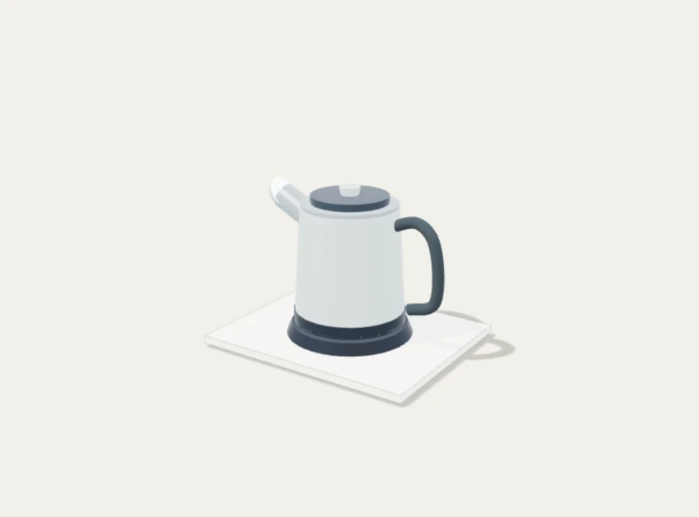
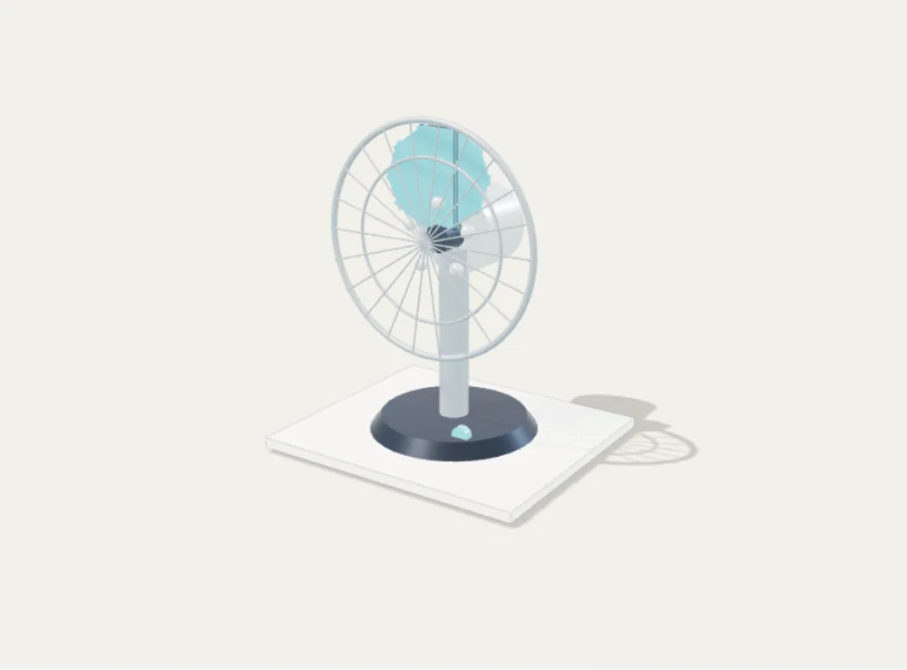
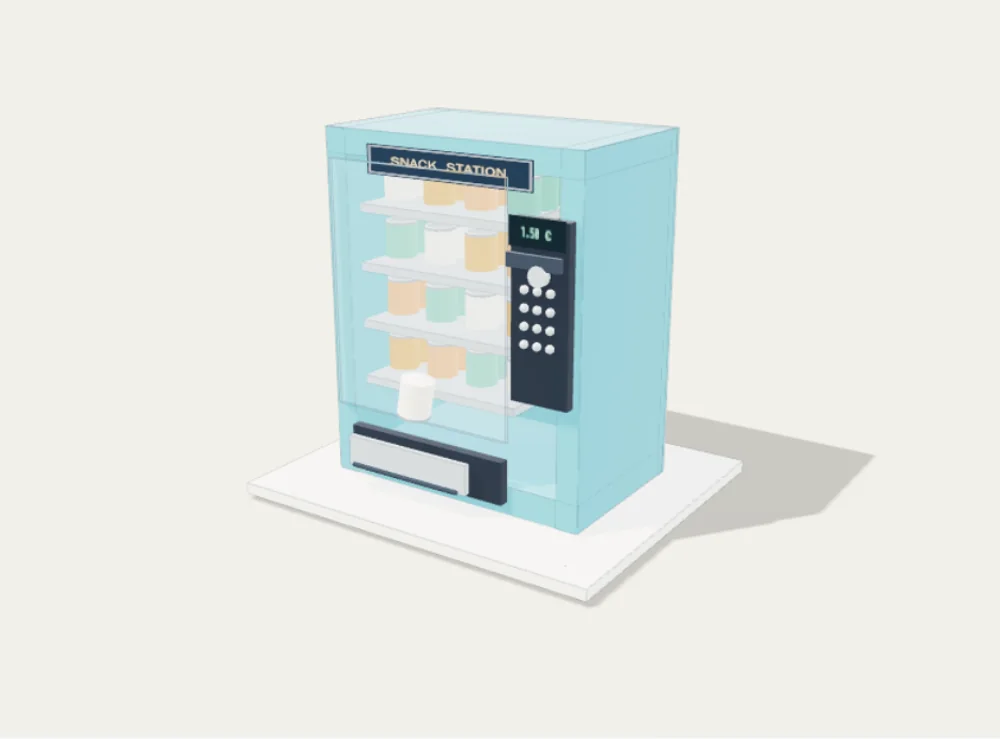
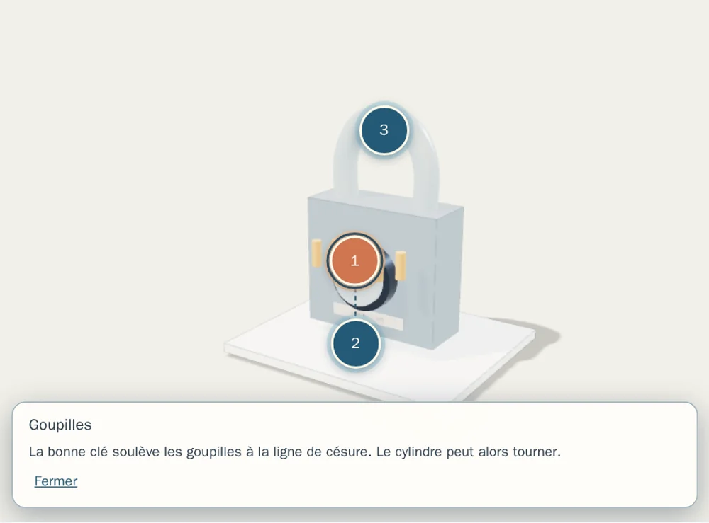
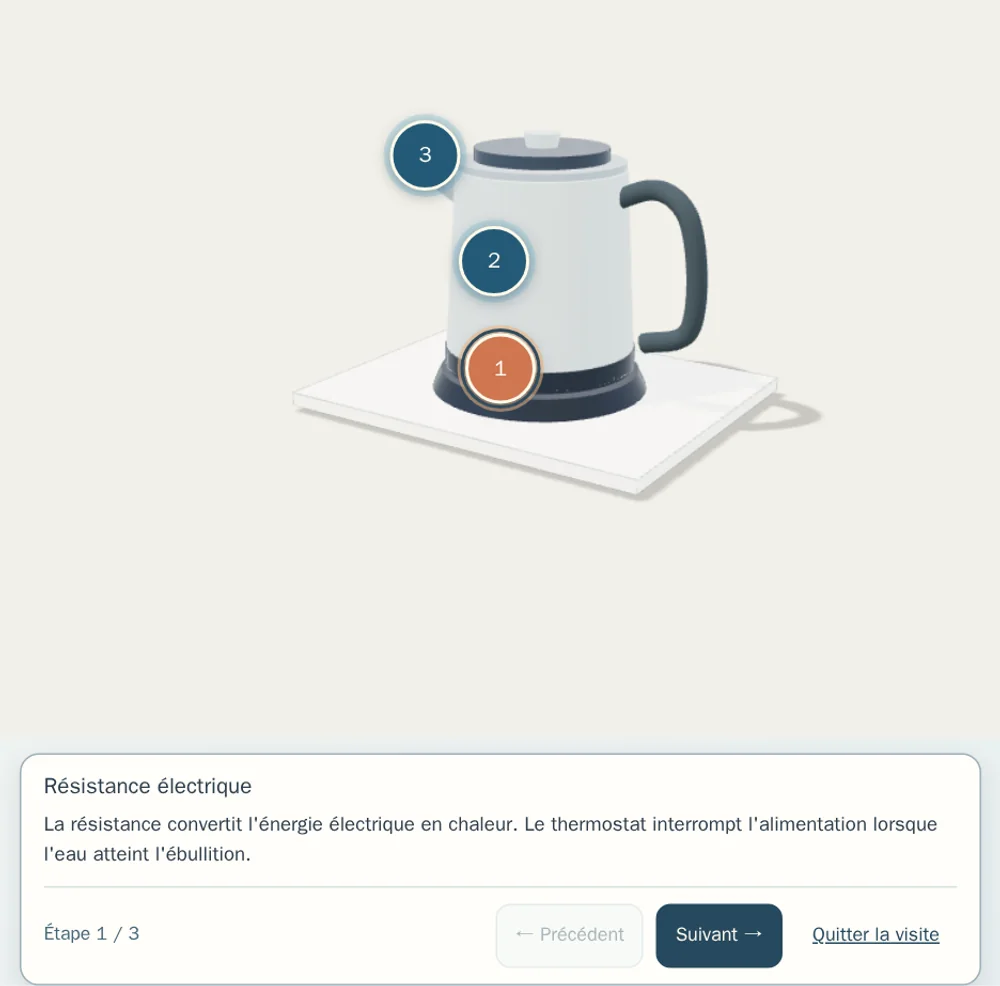

# Object Fonctionnement

Application Android éducative hors ligne.

## Interactive ColorFigures visualisations

The washing-machine and vending-machine pages at `public/figures/` are self-contained HTML built from the official ColorFigures archive, including the original engine and examples. They run offline inside an iframe with `sandbox="allow-scripts"` and do not need external requests. See `COLORFIGURES-LICENSE` (MIT, copyright April Zhu and Tolga Cohce). These are interactive educational models, not physical appliance emulators.

## Interactive ColorFigures visualisations

The washing-machine and vending-machine pages at `public/figures/` are self-contained HTML built from the official ColorFigures archive, including the original engine and examples. They run offline inside an iframe with `sandbox="allow-scripts"` and do not need external requests. See `COLORFIGURES-LICENSE` (MIT, copyright April Zhu and Tolga Cohce). These are interactive educational models, not physical appliance emulators.


## Interactions en 3D isométrique

Le catalogue comporte maintenant **9 objets**, tous avec une figure interactive :

| Objet | Interactions |
|---|---|
| Bouilloire | Remplissage, chauffe et arrêt thermique, versement, couvercle |
| Grille-pain | Insertion, niveau de brunissage, grillage et éjection |
| Ventilateur | Marche/arrêt, vitesse et oscillation |
| Serrure | Insertion de clé, alignement des goupilles, verrouillage |
| Pompe à vélo | Raccordement, coups de pompe, pression indicative |
| Cafetière filtre | Eau, filtre, extraction et service |
| Lampe | Interrupteur, intensité et compartiment piles |
| Lave-linge | Modèle original ColorFigures avec porte, tambour, tiroir et cycles |
| Distributeur | Modèle original ColorFigures avec monnaie, sélection et distribution |

Les **sept modèles nouveaux** sont définis dans `public/figures/objects.js` et
utilisent le moteur `public/figures/core.js`; les deux démonstrations
fournies avec ColorFigures sont intégrées sous forme HTML autonome.
Tous les scripts sont chargés localement, sans API ni pisteur.

**Licence tierce :** `COLORFIGURES-LICENSE` contient les crédits et
conditions MIT du moteur et des exemples. Les animations et vitesses
ne constituent **pas** des instructions de sécurité ni une réplique
exacte d'un modèle commercial; consulter les notices des fabricants.

## Tests et APK Android

```sh
npm install
npm run check
npm run build
npx cap add android
npx cap sync android
cd android && ./gradlew assembleDebug
```

GitHub Actions crée l'APK de débogage dans les artefacts du workflow.


### Générer de nouveaux aperçus

Les images du catalogue sont de vrais rendus ColorFigures, exportés au
format **WebP 480 × 360**, générés automatiquement depuis les modèles :

```sh
npm install
npx playwright install chromium
npm run generate:previews
```

La CI exécute également les tests Chromium à la largeur d'un écran Android :
vérification des interactions, du rendu SVG, des images et de la navigation.

```sh
npm run test:browser
```


## Confort et navigation Android

- Le bouton Retour physique revient à la liste lorsque la fiche d'un objet est ouverte.
- Depuis la liste principale, Retour minimise l'application au lieu de réouvrir
  une fiche depuis un historique artificiel.
- Les liens directs vers un objet et la navigation navigateur sont gérés
  sans dupliquer les entrées de l'historique.
- L'ajout ou le retrait d'un favori pendant la simulation ne redémarre pas le modèle.
- Les visualisations adaptent leur hauteur pour éviter un deuxième défilement
  à l'intérieur de la fiche sur Android.


## Recherche et accessibilité

La recherche accepte les mots sans accents et plusieurs termes
(par exemple cafe filtre ou bouilloire electrique). Les vues s'adaptent
aux smartphones étroits et aux tablettes. Les deux exemples originaux
ColorFigures disposent d'une traduction française de leurs contrôles.
L'application conserve la simulation active lorsqu'un favori est modifié.

GitHub Actions installe les dépendances à partir du fichier package-lock.json
via npm ci pour des builds reproductibles.


## Studio visuel et sonore (version 0.2)

- Palette enrichie, matériaux dessinés, halos de chaleur et de lumière,
  vapeur et filets d'air isométriques, écoulement et pulsations de pression.
- Les animations sont synchronisées avec les états des modèles :
  éjection progressive du grille-pain, rotation du barillet, variation du
  faisceau de la lampe, mouvement des pales, chauffe et extraction.
- Les bruitages sont générés localement par Web Audio : interrupteurs,
  moteurs, eau, vapeur, bulles, pièces, ressorts, pompe, serrure,
  gouttes et fin de cycle. Aucune bande-son tierce, aucun
  microphone ni pisteur.
- Le son est activé par défaut mais ne démarre qu'après une interaction.
  Il se coupe dans la page et dans l'application, avec préférence
  persistante entre les sessions.
- Ambiance sonore arrêtée lorsque le son est coupé ou la page fermée.
- Animations réduites si le système demande « réduire les animations ».
- Génération des neuf aperçus WebP dans la CI avant les tests.
- Moteur ColorFigures crédité sous licence MIT dans COLORFIGURES-LICENSE.

Les durées et sons sont stylisés, et non des reproductions exactes
d'appareils. Vérifier la qualité acoustique sur téléphone physique.


### Icône de l'application

L'identité visuelle comprend une icône originale (cube isométrique et
mécanisme central), fournie en SVG dans resources/app-icon.svg. La commande
npm run android:icons produit la favicon et les variantes PNG adaptées aux
densités Android, après la génération de la plateforme Capacitor.

La CI génère les icônes Android et renseigne versionCode 2 / versionName
0.2.0 pour cette évolution graphique et sonore.


## Version 0.3 — 3D en temps réel

Neuf scènes Three.js fonctionnent hors ligne avec de véritables
géométries, éclairages et matériaux PBR.

- Rotation tactile à un doigt et zoom à deux doigts.
- Recentrage caméra et vue technique translucide des pièces internes.
- Synchronisation des modèles 3D avec les commandes ColorFigures.
- Bascule 2D/3D sans perte des interactions et repli 2D si WebGL échoue.
- Mise au repos du GPU à l'arrêt, résolution plafonnée, libération des
  contextes graphiques lors des changements de fiche.
- Volume 0–100 % mémorisé et léger panoramique stéréo des bruitages.

Tous les sons sont synthétisés localement. Les géométries et matériaux
sont originaux. Aucun serveur, téléchargement de modèle ou pisteur.

Ces coupes et simulations sont pédagogiques, non des plans de démontage
ou d'entretien. Les performances et sons devront être contrôlés sur
plusieurs appareils Android physiques.

### Licences tierces

ColorFigures : MIT (COLORFIGURES-LICENSE).
Three.js : MIT (licenses/THREE-LICENSE), https://threejs.org/.

### Validation

npm ci, npm run check, npm run test:browser, npm run build,
npm run android:sync.

La CI génère l'APK Android de test 0.3.0, versionCode 3.


### Aperçus de la 3D temps réel





Pour régénérer ces captures via Chromium :

    npm run generate:3d-previews

Les rendus sont construits depuis les mêmes modèles Three.js que l'APK.


## Version 0.4 — inspection des mécanismes

Les neuf modèles 3D peuvent désormais être explorés directement avec le
bouton **Identifier les pièces**. Chaque objet propose trois composants
documentés (27 au total), dont les repères sont ancrés sur la géométrie.
Appuyer sur un repère affiche une explication en français et cadre la caméra
sur le composant. Les repères proches sont automatiquement espacés et reliés
à leur ancrage par un trait de rappel.

Utilisation : ouvrir un objet, afficher la 3D, choisir « Identifier les
pièces », sélectionner un numéro puis « Fermer » pour poursuivre
l'exploration. Le mode coupe/transparence demeure disponible. Les modèles
restent des simplifications pédagogiques, pas des instructions de réparation.

Améliorations techniques :
- Le canevas WebGL occupe désormais toute la largeur de son conteneur
  après l'ouverture d'une fiche (correction d'une ancienne largeur fixe).
- Les cibles tactiles des repères mesurent 44 × 44 px, et l'explication
  est accessible au clavier et avec un lecteur d'écran.
- Le cadrage animé respecte le réglage système de réduction des animations.
- Retour automatique à ColorFigures 2D lorsque le contexte WebGL est perdu.
- Libération des géométries, textures et matériaux créés par chaque scène.
- Tests automatisés des 27 positions, de la sélection des pièces, du
  chevauchement des repères, du redimensionnement et de la perte WebGL.

Capture réelle de la nouvelle fonctionnalité :



Pour régénérer les captures des objets et de l'inspection :
npm run generate:3d-previews.

GitHub Actions construit l'APK de test Android 0.4.0, versionCode 4.


## Version 0.5 — visites guidées hors ligne

Chaque modèle 3D propose désormais une visite structurée de ses trois
composants. Utiliser le bouton **Visite guidée**, puis **Précédent**,
**Suivant**, **Terminer la visite** ou **Quitter la visite**.

La caméra cadre successivement les mécanismes et une explication en
français accompagne chaque étape. La fiche d'explication est placée
sous le canevas : elle ne masque plus les mécanismes sur téléphone.
L'utilisateur reste libre de faire tourner le modèle, de zoomer et
d'actionner les commandes de simulation.

Seule l'action explicite **Terminer la visite** enregistre la visite
comme effectuée. Annuler n'enregistre rien. Le catalogue indique les
visites terminées et affiche un compteur sur les neuf objets. Ces
informations sont stockées localement dans l'application, sans
compte utilisateur ni synchronisation distante. Le progrès peut être
relu à une autre session et la visite reste rejouable.

Cette progression atteste seulement que les étapes ont été parcourues :
elle n'évalue ni les connaissances ni les capacités de réparation.



Les vérifications CI couvrent l'annulation, les trois étapes,
la navigation avant/arrière, la persistance et les tailles d'écran
320, 390 et 768 px.

La CI produit l'APK Android de test **0.5.0 (versionCode 5)**.


## Version 0.6 — Vérification des connaissances

Après avoir consulté un objet, l'utilisateur peut répondre à une question
sur le mécanisme ou sa fonction. Les neuf questions possèdent trois réponses
possibles et une explication pédagogique. Une réponse incorrecte ne compte
pas comme réussie, mais affiche la correction pour apprendre.

Les validations sont sauvegardées localement sur l'appareil, sans compte,
serveur, télémétrie ni connexion réseau. Le catalogue indique le nombre
de connaissances validées parmi les neuf objets. Les questions ne
réinitialisent pas les simulations 2D ou 3D en cours.

Les 9 fiches sont couvertes par les tests unitaires, et le scénario de
réponse incorrecte, réponse correcte et persistance par un test Chromium.
La CI prépare l'APK de test Android 0.6.0 (versionCode 6).


## Version 0.7 — révisions ciblées

Un bouton « À réviser » filtre les objets dont le quiz n'a pas encore
été réussi. Le compteur se met à jour à partir de la progression
existante, enregistrée uniquement dans le stockage local Android.
Ce filtre fonctionne avec les catégories et les favoris, sans modifier
les mécanismes ni effacer les progrès.

Pendant un quiz, une mauvaise réponse est indiquée sans révéler
immédiatement la réponse exacte. L'utilisateur peut réessayer.
Une bonne réponse explique le mécanisme puis verrouille la question
pour éviter les saisies répétées. Les résultats réussis sont conservés.

GitHub Actions construit l'APK Android 0.7.0 (versionCode 7).
