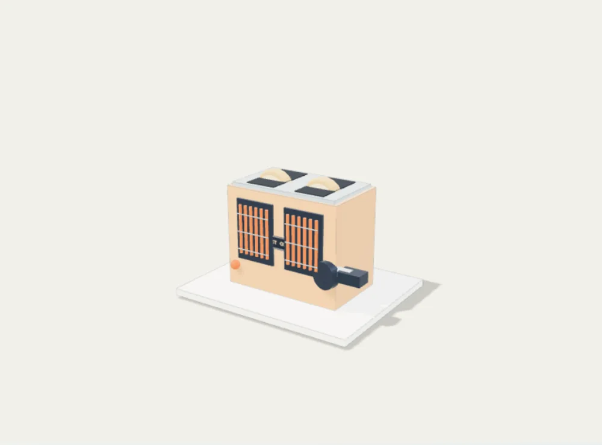
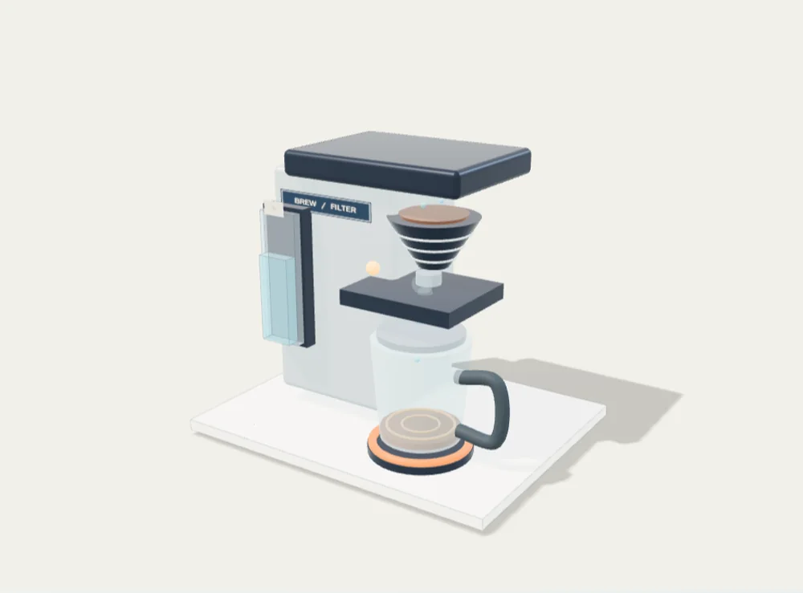
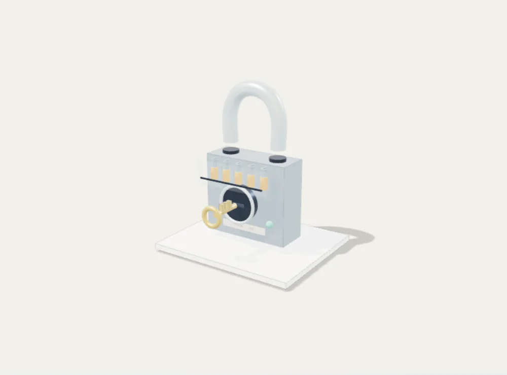
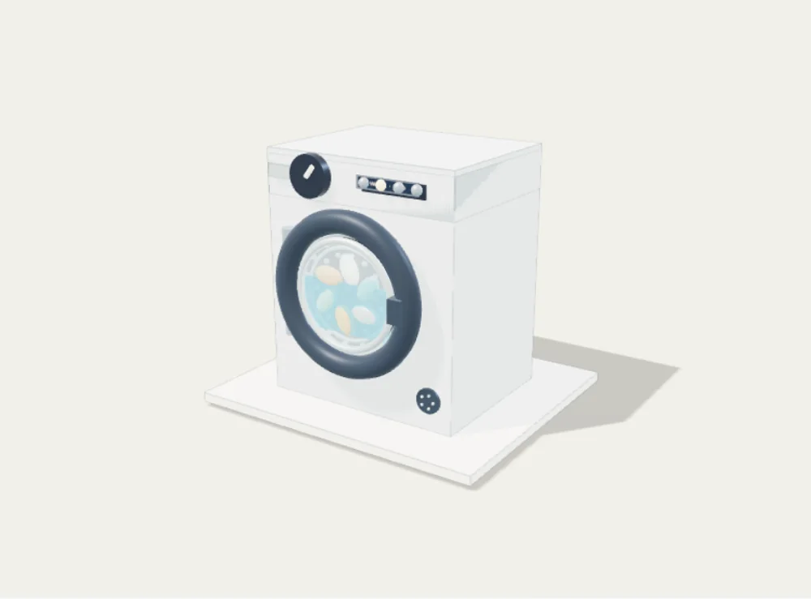
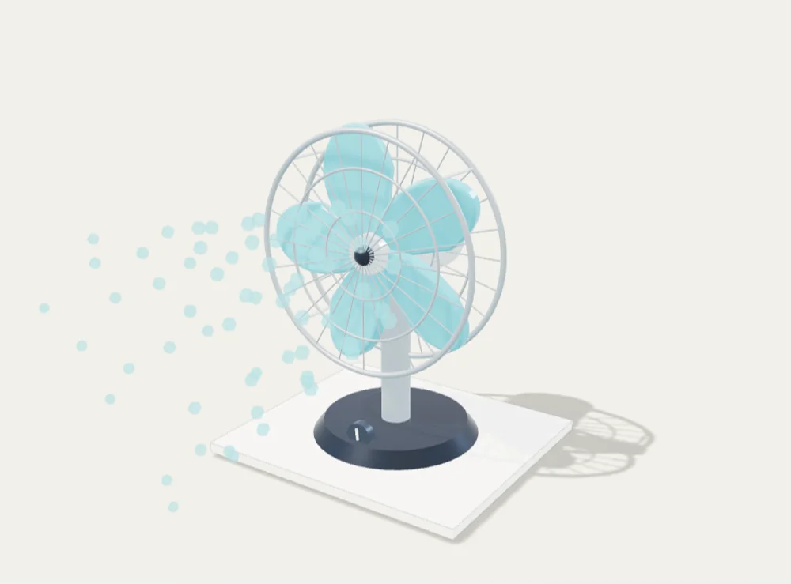

# Object Fonctionnement

Application Android éducative hors ligne.

## Interactive ColorFigures visualisations

The washing-machine and vending-machine pages at `public/figures/` are self-contained HTML built from the official ColorFigures archive, including the original engine and examples. They run offline inside an iframe with `sandbox="allow-scripts"` and do not need external requests. See `COLORFIGURES-LICENSE` (MIT, copyright April Zhu and Tolga Cohce). These are interactive educational models, not physical appliance emulators.

## Interactive ColorFigures visualisations

The washing-machine and vending-machine pages at `public/figures/` are self-contained HTML built from the official ColorFigures archive, including the original engine and examples. They run offline inside an iframe with `sandbox="allow-scripts"` and do not need external requests. See `COLORFIGURES-LICENSE` (MIT, copyright April Zhu and Tolga Cohce). These are interactive educational models, not physical appliance emulators.


## Interactions en 3D isométrique

Le catalogue comporte maintenant **9 objets**, tous avec une figure interactive :

| Objet | Interactions |
|---|---|
| Bouilloire | Remplissage, chauffe et arrêt thermique, versement, couvercle |
| Grille-pain | Insertion, niveau de brunissage, grillage et éjection |
| Ventilateur | Marche/arrêt, vitesse et oscillation |
| Serrure | Insertion de clé, alignement des goupilles, verrouillage |
| Pompe à vélo | Raccordement, coups de pompe, pression indicative |
| Cafetière filtre | Eau, filtre, extraction et service |
| Lampe | Interrupteur, intensité et compartiment piles |
| Lave-linge | Modèle original ColorFigures avec porte, tambour, tiroir et cycles |
| Distributeur | Modèle original ColorFigures avec monnaie, sélection et distribution |

Les **sept modèles nouveaux** sont définis dans `public/figures/objects.js` et
utilisent le moteur `public/figures/core.js`; les deux démonstrations
fournies avec ColorFigures sont intégrées sous forme HTML autonome.
Tous les scripts sont chargés localement, sans API ni pisteur.

**Licence tierce :** `COLORFIGURES-LICENSE` contient les crédits et
conditions MIT du moteur et des exemples. Les animations et vitesses
ne constituent **pas** des instructions de sécurité ni une réplique
exacte d'un modèle commercial; consulter les notices des fabricants.

## Tests et APK Android

```sh
npm install
npm run check
npm run build
npx cap add android
npx cap sync android
cd android && ./gradlew assembleDebug
```

GitHub Actions crée l'APK de débogage dans les artefacts du workflow.


### Générer de nouveaux aperçus

Les images du catalogue sont de vrais rendus ColorFigures, exportés au
format **WebP 480 × 360**, générés automatiquement depuis les modèles :

```sh
npm install
npx playwright install chromium
npm run generate:previews
```

La CI exécute également les tests Chromium à la largeur d'un écran Android :
vérification des interactions, du rendu SVG, des images et de la navigation.

```sh
npm run test:browser
```


## Confort et navigation Android

- Le bouton Retour physique revient à la liste lorsque la fiche d'un objet est ouverte.
- Depuis la liste principale, Retour minimise l'application au lieu de réouvrir
  une fiche depuis un historique artificiel.
- Les liens directs vers un objet et la navigation navigateur sont gérés
  sans dupliquer les entrées de l'historique.
- L'ajout ou le retrait d'un favori pendant la simulation ne redémarre pas le modèle.
- Les visualisations adaptent leur hauteur pour éviter un deuxième défilement
  à l'intérieur de la fiche sur Android.


## Recherche et accessibilité

La recherche accepte les mots sans accents et plusieurs termes
(par exemple cafe filtre ou bouilloire electrique). Les vues s'adaptent
aux smartphones étroits et aux tablettes. Les deux exemples originaux
ColorFigures disposent d'une traduction française de leurs contrôles.
L'application conserve la simulation active lorsqu'un favori est modifié.

GitHub Actions installe les dépendances à partir du fichier package-lock.json
via npm ci pour des builds reproductibles.


## Studio visuel et sonore (version 0.2)

- Palette enrichie, matériaux dessinés, halos de chaleur et de lumière,
  vapeur et filets d'air isométriques, écoulement et pulsations de pression.
- Les animations sont synchronisées avec les états des modèles :
  éjection progressive du grille-pain, rotation du barillet, variation du
  faisceau de la lampe, mouvement des pales, chauffe et extraction.
- Les bruitages sont générés localement par Web Audio : interrupteurs,
  moteurs, eau, vapeur, bulles, pièces, ressorts, pompe, serrure,
  gouttes et fin de cycle. Aucune bande-son tierce, aucun
  microphone ni pisteur.
- Le son est activé par défaut mais ne démarre qu'après une interaction.
  Il se coupe dans la page et dans l'application, avec préférence
  persistante entre les sessions.
- Ambiance sonore arrêtée lorsque le son est coupé ou la page fermée.
- Animations réduites si le système demande « réduire les animations ».
- Génération des neuf aperçus WebP dans la CI avant les tests.
- Moteur ColorFigures crédité sous licence MIT dans COLORFIGURES-LICENSE.

Les durées et sons sont stylisés, et non des reproductions exactes
d'appareils. Vérifier la qualité acoustique sur téléphone physique.


### Icône de l'application

L'identité visuelle comprend une icône originale (cube isométrique et
mécanisme central), fournie en SVG dans resources/app-icon.svg. La commande
npm run android:icons produit la favicon et les variantes PNG adaptées aux
densités Android, après la génération de la plateforme Capacitor.

La CI génère les icônes Android et renseigne versionCode 2 / versionName
0.2.0 pour cette évolution graphique et sonore.


## Version 0.3 — 3D en temps réel

Neuf scènes Three.js fonctionnent hors ligne avec de véritables
géométries, éclairages et matériaux PBR.

- Rotation tactile à un doigt et zoom à deux doigts.
- Recentrage caméra et vue technique translucide des pièces internes.
- Synchronisation des modèles 3D avec les commandes ColorFigures.
- Bascule 2D/3D sans perte des interactions et repli 2D si WebGL échoue.
- Mise au repos du GPU à l'arrêt, résolution plafonnée, libération des
  contextes graphiques lors des changements de fiche.
- Volume 0–100 % mémorisé et léger panoramique stéréo des bruitages.

Tous les sons sont synthétisés localement. Les géométries et matériaux
sont originaux. Aucun serveur, téléchargement de modèle ou pisteur.

Ces coupes et simulations sont pédagogiques, non des plans de démontage
ou d'entretien. Les performances et sons devront être contrôlés sur
plusieurs appareils Android physiques.

### Licences tierces

ColorFigures : MIT (COLORFIGURES-LICENSE).
Three.js : MIT (licenses/THREE-LICENSE), https://threejs.org/.

### Validation

npm ci, npm run check, npm run test:browser, npm run build,
npm run android:sync.

La CI génère l'APK Android de test 0.3.0, versionCode 3.


### Aperçus de la 3D temps réel


Pour régénérer ces captures via Chromium :

    npm run generate:3d-previews

Les rendus sont construits depuis les mêmes modèles Three.js que l'APK.


## Version 0.4 — inspection des mécanismes

Les neuf modèles 3D peuvent désormais être explorés directement avec le
bouton **Identifier les pièces**. Chaque objet propose trois composants
documentés (27 au total), dont les repères sont ancrés sur la géométrie.
Appuyer sur un repère affiche une explication en français et cadre la caméra
sur le composant. Les repères proches sont automatiquement espacés et reliés
à leur ancrage par un trait de rappel.

Utilisation : ouvrir un objet, afficher la 3D, choisir « Identifier les
pièces », sélectionner un numéro puis « Fermer » pour poursuivre
l'exploration. Le mode coupe/transparence demeure disponible. Les modèles
restent des simplifications pédagogiques, pas des instructions de réparation.

Améliorations techniques :
- Le canevas WebGL occupe désormais toute la largeur de son conteneur
  après l'ouverture d'une fiche (correction d'une ancienne largeur fixe).
- Les cibles tactiles des repères mesurent 44 × 44 px, et l'explication
  est accessible au clavier et avec un lecteur d'écran.
- Le cadrage animé respecte le réglage système de réduction des animations.
- Retour automatique à ColorFigures 2D lorsque le contexte WebGL est perdu.
- Libération des géométries, textures et matériaux créés par chaque scène.
- Tests automatisés des 27 positions, de la sélection des pièces, du
  chevauchement des repères, du redimensionnement et de la perte WebGL.

Capture réelle de la nouvelle fonctionnalité :


Pour régénérer les captures des objets et de l'inspection :
npm run generate:3d-previews.

GitHub Actions construit l'APK de test Android 0.4.0, versionCode 4.


## Version 0.5 — visites guidées hors ligne

Chaque modèle 3D propose désormais une visite structurée de ses trois
composants. Utiliser le bouton **Visite guidée**, puis **Précédent**,
**Suivant**, **Terminer la visite** ou **Quitter la visite**.

La caméra cadre successivement les mécanismes et une explication en
français accompagne chaque étape. La fiche d'explication est placée
sous le canevas : elle ne masque plus les mécanismes sur téléphone.
L'utilisateur reste libre de faire tourner le modèle, de zoomer et
d'actionner les commandes de simulation.

Seule l'action explicite **Terminer la visite** enregistre la visite
comme effectuée. Annuler n'enregistre rien. Le catalogue indique les
visites terminées et affiche un compteur sur les neuf objets. Ces
informations sont stockées localement dans l'application, sans
compte utilisateur ni synchronisation distante. Le progrès peut être
relu à une autre session et la visite reste rejouable.

Cette progression atteste seulement que les étapes ont été parcourues :
elle n'évalue ni les connaissances ni les capacités de réparation.


Les vérifications CI couvrent l'annulation, les trois étapes,
la navigation avant/arrière, la persistance et les tailles d'écran
320, 390 et 768 px.

La CI produit l'APK Android de test **0.5.0 (versionCode 5)**.


## Version 0.6 — Vérification des connaissances

Après avoir consulté un objet, l'utilisateur peut répondre à une question
sur le mécanisme ou sa fonction. Les neuf questions possèdent trois réponses
possibles et une explication pédagogique. Une réponse incorrecte ne compte
pas comme réussie, mais affiche la correction pour apprendre.

Les validations sont sauvegardées localement sur l'appareil, sans compte,
serveur, télémétrie ni connexion réseau. Le catalogue indique le nombre
de connaissances validées parmi les neuf objets. Les questions ne
réinitialisent pas les simulations 2D ou 3D en cours.

Les 9 fiches sont couvertes par les tests unitaires, et le scénario de
réponse incorrecte, réponse correcte et persistance par un test Chromium.
La CI prépare l'APK de test Android 0.6.0 (versionCode 6).


## Version 0.7 — révisions ciblées

Un bouton « À réviser » filtre les objets dont le quiz n'a pas encore
été réussi. Le compteur se met à jour à partir de la progression
existante, enregistrée uniquement dans le stockage local Android.
Ce filtre fonctionne avec les catégories et les favoris, sans modifier
les mécanismes ni effacer les progrès.

Pendant un quiz, une mauvaise réponse est indiquée sans révéler
immédiatement la réponse exacte. L'utilisateur peut réessayer.
Une bonne réponse explique le mécanisme puis verrouille la question
pour éviter les saisies répétées. Les résultats réussis sont conservés.

GitHub Actions construit l'APK Android 0.7.0 (versionCode 7).


## Version 0.8 — glossaire interactif

Le catalogue dispose d'un glossaire hors ligne qui indexe
automatiquement les composants de la vue 3D (27 fiches pour neuf objets).
Il ne duplique pas les explications : les descriptions proviennent directement
du fichier src/part-annotations.js, la source utilisée par les modèles.

- Recherche en français, sans distinction d'accents ou de casse.
- Recherche sur plusieurs mots, le composant, l'objet et l'explication.
- Depuis une fiche de glossaire, Voir en 3D ouvre le modèle concerné
  et cadre automatiquement la caméra sur le composant décrit.
- Le texte recherché est conservé pendant le retour au catalogue.
- Si WebGL est indisponible, la fiche de l'objet reste accessible en mode 2D.
- Tout le contenu fonctionne hors ligne, sans compte ni collecte de données.

Tests ajoutés : exhaustivité du glossaire, recherche multi-termes,
ouverture d'un composant et navigation retour.

La CI construit l'APK Android 0.8.0 (versionCode 8).


## Version 0.9 — moteur du ventilateur

Le modèle 3D du ventilateur bénéficie d'une hélice profilée à cinq pales,
disposées autour du même axe, ainsi que d'un moyeu distinct et d'une grille
de protection fixe. La rotation suit l'état réellement fourni par la
simulation ColorFigures ; la vitesse et l'oscillation restent contrôlées
par les commandes existantes. Les détails sont générés hors ligne par
Three.js, sans texture ni ressource tierce.

Des tests navigateur vérifient le mouvement sous tension et l'oscillation.
Un test de régression vérifie l'architecture de l'hélice et de la cage.

VersionCode Android 9, versionName 0.9.0.


## Version 0.10 — ventilateur 3D plus détaillé

Le ventilateur dispose désormais de deux grilles de protection distinctes,
avant et arrière, avec des cercles concentriques et quatre traverses
latérales. Leur parallaxe est visible lors de la rotation de la caméra.
Le rotor à cinq pales courbes continue de tourner indépendamment de
la cage. La base intègre un sélecteur de vitesse et trois voyants
dont l'état est synchronisé avec la simulation existante.

La géométrie reste entièrement procédurale et disponible hors ligne.
Les tests de catalogue, d'interaction et de rendu 3D restent actifs.
La CI construit l'APK Android 0.10.0 (versionCode 10).


## Version 0.11 — trois appareils 3D améliorés

Cette version approfondit les visualisations procédurales sans ajouter
de ressources distantes :

- **Bouilloire :** jauge d'eau graduée nettement visible sur la face avant,
  niveau lié aux actions, couvercle sur charnière qui s'ouvre
  progressivement, anneau chauffant et vapeur.
- **Grille-pain :** deux chambres avec résistances visibles et protections,
  tranches arrondies avec croûte et mie qui brunissent selon la cuisson,
  chariot à levier et éjection synchronisés.
- **Cafetière filtre :** réservoir transparent déplacé sur la face visible,
  eau à niveau variable, filtre avec café moulu, gouttes d'eau chaude,
  verseuse qui se remplit et vapeur stylisée.
- **Animations :** correction du passage du temps absolu au moteur pour
  la bouilloire, la cafetière, le lave-linge et le distributeur.
  Le couvercle continue son interpolation jusqu'à sa position finale.
- **Tests visuels :** Playwright et Sharp comparent les images réelles du
  WebGL avant et après une action sur les trois appareils. Le mouvement
  du couvercle est également vérifié.

Captures générées depuis les modèles réels :





Ces modèles restent des schémas pédagogiques stylisés, et non des
reconstitutions industrielles exactes. Les sons existants demeurent
générés localement, sans piste audio téléchargée.

GitHub Actions produit l'APK Android de test 0.11.0 (versionCode 11).


## Version 0.12 — pompe à vélo : cinématique du piston

Le modèle 3D de la pompe à vélo présente désormais une tige de piston
reliée au déplacement de la poignée. Un joint, des repose-pieds,
un raccord de valve et un témoin de pression enrichissent la mécanique
visible. L'aiguille du manomètre reste synchronisée avec la pression
de la simulation ColorFigures existante. Aucun téléchargement ni
permission Android supplémentaire n'est nécessaire.

Tests : 25 vérifications unitaires, tous les scénarios navigateur
et les neuf modèles 3D. APK de test Android 0.12.0 (versionCode 12).


## Version 0.13 — mécanismes 3D du cadenas, lave-linge et distributeur

Cette version améliore les trois objets dont les mécanismes étaient
insuffisamment représentés dans la visualisation 3D.

- **Serrure** : cinq goupilles et leurs ressorts visibles dans une
  fenêtre translucide ; barillet et clé pivotant sur le même axe,
  anse du cadenas animée lors du déverrouillage.
- **Lave-linge** : tambour indépendant de la porte articulée, linge
  représenté à l'intérieur du tambour, remplissage et vidange visibles,
  indicateurs des phases de cycle, sélecteur et tiroir à lessive.
  Les phases suivent les mêmes durées que la simulation ColorFigures.
- **Distributeur** : meuble réellement creux, 4 × 4 emplacements avec
  jusqu'à trois produits en profondeur, stock et crédit visibles,
  produit animé de l'étagère vers le bac, trappe articulée et pièces rendues.
- **Son** : les bruitages du lave-linge distinguent l'arrivée d'eau,
  le lavage, la vidange et l'essorage ; le moteur se tait pendant la
  pause. Tous les sons restent synthétisés sur l'appareil.
- **Communication** : l'état imbriqué des stocks, de la chute et du
  bac du distributeur est transmis par messages locaux limités aux
  champs nécessaires, sans service externe ni permission supplémentaire.

Le mode illustrations 2D, la navigation, le glossaire, les leçons 3D,
la progression et les quiz sont conservés. Les représentations restent
des modèles pédagogiques et non des plans de réparation.

### Nouveaux aperçus Three.js





Captures créées par npm run generate:3d-previews. La CI construit
l'APK Android de test 0.13.0 avec versionCode 13.


## Version 0.14 — optique de la lampe torche

Le modèle 3D de la lampe torche possède désormais un réflecteur
métallique, trois anneaux concentriques de lentille, une bague de
protection, un bouchon arrière et un bouton qui s'enfonce à
l'allumage. La source lumineuse et le faisceau restent pilotés par
la simulation d'origine. Tous les éléments sont procéduraux,
sans téléchargement supplémentaire.

28 tests unitaires et les scénarios navigateur passent.
La CI produit l'APK Android 0.14.0 (versionCode 14).


## Version 0.15 — qualité graphique 3D adaptée à Android

Chaque fiche d'objet propose désormais trois qualités graphiques sélectionnables
sans interrompre la simulation ni perdre les progrès :

- Automatique (par défaut) : densité de pixels limitée à 1,2 sur les écrans
  compacts, 1,5 sur les plus grands, et ombres en 512 ou 1024 points.
- Économie : densité de pixels de 1, ombres en 256 points et cadence
  d'animation plafonnée à environ 20 images/seconde pour réduire la charge GPU.
- Haute qualité : densité de pixels jusqu'à 2, ombres en 1024 points et
  cadence d'animation d'environ 30 images/seconde.

Le choix est conservé dans le stockage local, appliqué aux neuf modèles 3D,
et modifiable instantanément sur une fiche. Les rendus statiques continuent
de mettre le GPU en veille, conformément à la version précédente. Le réglage
Automatique respecte les préférences de réduction des animations du système.

Tests : validations des profils, stockage résilient et tests navigateur réels
de changement de résolution, de persistance et de veille GPU. GitHub Actions
construit l'APK Android 0.15.0 (versionCode 15).

Les modèles restent des schémas pédagogiques ; ce réglage améliore leur
netteté et leur coût GPU, pas leur précision mécanique.


## Version 0.16 — matériaux procéduraux et repères 3D

Les neuf modèles 3D utilisent désormais des microtextures déterministes,
générées localement (128 × 128), pour différencier l'acier brossé, les
plastiques moulés et les surfaces caoutchoutées. Les cartes de rugosité
et de léger relief sont partagées entre les modèles ; aucune connexion
internet ni nouvelle ressource distante n'est requise.

Lors de l'inspection d'une pièce ou d'une visite guidée, un repère
lumineux 3D indique sa position réelle dans le modèle. Il disparaît
à la fermeture de l'explication, à la fin de la visite ou lorsque les
repères sont masqués. Cet effet est statique : il ne demande pas de
boucle d'animation supplémentaire sur Android.

Les profils de qualité graphique Automatique, Économie et Haute
qualité restent disponibles ; le moteur conserve la mise en veille
des rendus statiques et le repli 2D.

Tests : 32 contrôles unitaires, contrôles déterministes des textures,
tests navigateur des neuf objets et cycle de vie des repères de pièces.
GitHub Actions construit l'APK Android 0.16.0 (versionCode 16).


## Version 0.17 — visualisation 3D du flux d'air

Le ventilateur 3D propose maintenant « Visualiser le flux d'air ».
Quand le moteur fonctionne, un ensemble de petites particules
se déplace depuis la grille avant vers l'extérieur et suit
l'oscillation de la tête. Les particules disparaissent lorsque le
moteur est arrêté ou lorsque le réglage est désactivé.
Cette représentation schématique explique le principe des
pales inclinées : il ne s'agit pas d'une mesure aérodynamique.

L'effet est réalisé par un seul InstancedMesh Three.js
(pas 64 objets avec 64 appels GPU). Le nombre de particules
dépend du profil graphique Android : 24 en Économie, 40 en
Automatique et 64 en Haute qualité. Le calcul est déterministe,
hors ligne, et la préférence d'affichage est conservée localement.
En dehors du ventilateur, l'interface ne présente pas ce réglage.



Les tests vérifient les positions des particules, leur mouvement
et leur adaptation à la vitesse, le changement visuel réel en
Chromium, la persistance, et l'interface à 320 px. Les neuf
modèles 3D et les interactions précédentes continuent d'être testés.

Version Android 0.17.0, versionCode 17, APK de test
généré par GitHub Actions.


## Version 0.18 — tambour de lave-linge et tiroir à lessive

Le lave-linge 3D possède désormais un tambour avec 96 perforations
concentriques dessinées par une seule instance GPU (InstancedMesh).
Trois aubes de brassage sont solidaires du tambour et suivent sa
rotation pendant les phases de lavage et d'essorage. Le tiroir
à lessive comporte deux compartiments séparés, visibles lors de
son ouverture. La simulation, les niveaux d'eau et la gestion des
cycles existants sont conservés.

Les détails sont procéduraux et hors ligne. Les profils de qualité
graphique et le rendu à la demande restent actifs pour les appareils
Android modestes.

34 tests unitaires et tous les scénarios navigateur passent.
La CI produit l'APK Android 0.18.0 (versionCode 18).


## Version 0.19 — distribution mécanique et extraction du café

Le distributeur 3D respecte les **16 références de la simulation ColorFigures** :
les rangées A et B vendent des canettes, C des bouteilles, et D des sachets.
Les couleurs de chaque emplacement reproduisent les couleurs d'origine.
Les 48 unités en stock, le produit qui tombe et le produit récupéré
dans le bac partagent désormais la forme et la couleur de leur référence.

Chaque colonne dispose d'une **spirale électromécanique**. Les 16 spirales
sont rendues par une unique géométrie instanciée ; seule celle de la
référence sélectionnée pivote d'un tour pendant la distribution. Les
quantités en stock, le crédit, la chute et le volet restent synchronisés
avec la simulation originale. Les objets instanciés libèrent explicitement
leurs buffers GPU lors du changement de modèle.

La cafetière 3D comporte maintenant des nervures métalliques sur le
porte-filtre, une plaque chauffante dont la lumière réagit à l'extraction,
et deux ondulations suivant le niveau réel de café dans la verseuse.
Les nouveaux éléments sont entièrement procéduraux et hors ligne.

Tests : 37 tests unitaires (incluant les références, couleurs et limites
des 16 sélections) ; tests navigateur des neuf modèles, de la vue 3D,
et différences visuelles des produits B3, C2, D4 dans le bac. Profils de
qualité graphique et repli 2D conservés. APK Android 0.19.0 (versionCode 19).


## Version 0.20 — distribution en trois phases et bruitages synchronisés

Le distributeur pédagogique présente désormais la transaction en cours
sur son écran 3D, avec le code A1–D4 de l'article sélectionné, la
progression de la distribution et l'indication de récupération. Les
montants restent calculés par la simulation ColorFigures d'origine.

L'animation de chute est organisée en trois étapes temporelles continues :
libération de la spirale, descente accélérée vers le bac, puis réception
avec un léger rebond. Ces mouvements sont pilotés exclusivement par
drop.r, drop.c et drop.t (sans achat artificiel ni état divergent).
Le code est isolé dans des fonctions pures testables.

Le moteur de bruitages local Web Audio distingue désormais la mise en
route de la spirale, la réception dans le bac et l'enlèvement du produit.
Il produit également un bruit d'arrivée d'eau au démarrage du café.
Tous ces sons respectent l'activation par un geste, le volume utilisateur,
la coupure du son et l'arrêt hors premier plan. Aucun fichier audio ou
service externe n'est ajouté.

Validation : 39 tests unitaires, scénarios Chromium complets, y compris
les transitions audio et les neuf objets 3D. Les trois profils graphiques,
le rendu GPU à la demande et la vue de secours 2D restent disponibles.
La CI GitHub produit l'APK Android de test 0.20.0 (versionCode 20).


## Version 0.21 — circulation de l'eau dans la cafetière

La cafetière 3D possède maintenant un circuit transparent externe, du
réservoir jusqu'à la douche d'extraction, avec six gouttelettes animées.
Ce flux apparaît seulement lorsque l'extraction est active et que le
réservoir contient de l'eau. Le niveau de la verseuse, la plaque
chauffante et les gouttes de café restent synchronisés avec la
simulation d'origine. Aucun accès réseau ni ressource nouvelle.

39 tests unitaires et les scénarios navigateur passent. La CI
construit l'APK Android 0.21.0 (versionCode 21).


## Version 0.22 — parcours du mécanisme en trois étapes

Chaque objet dispose désormais d'un mode **Comprendre le mécanisme**,
distinct des 27 fiches du glossaire et des visites guidées existantes.
Les neuf parcours (27 étapes au total) présentent dans leur ordre les
principales fonctions de l'objet. L'utilisateur choisit une étape ou
utilise les boutons Précédent et Suivant pour parcourir les explications
avec recentrage de la caméra et repère lumineux.

Deux flèches SVG relient les trois composants ancrés sur les vrais modèles
3D et suivent la rotation/zoom de la caméra. Il s'agit de liens causaux
**schématiques**, pas de conduites, câblages ou chemins physiques réels.
Le mode évite de superposer les repères de la visite guidée aux flèches,
et se ferme automatiquement si l'on passe à une visite guidée,
à l'inspection des composants, ou au recentrage de la caméra.

L'interface fonctionne hors ligne, comprend de grandes cibles tactiles
sur Android, respecte le mode d'animation réduite et n'ajoute aucune
boucle de rendu GPU permanente. Le mode 2D de secours est inchangé.

Captures réelles :
- [Parcours de la cafetière](docs/previews/coffee-mechanism-flow.webp)
- [Parcours du distributeur](docs/previews/vending-mechanism-flow.webp)

Tests : 42 tests unitaires, scénarios Chromium sur les neuf modèles,
navigation entre les trois étapes, retour aux visites guidées,
réinitialisation et ergonomie Android 320/390/768 px.
L'APK Android 0.22.0 est construit en CI avec versionCode 22.


## Version 0.23 — progression des visites guidées 3D

Les visites des trois pièces de chacun des neuf modèles possèdent
une barre de progression visible, mise à jour avec Précédent et
Suivant, et remise à zéro à la fermeture ou à l'achèvement.
Les flèches gauche et droite permettent également de naviguer
dans la visite au clavier ; Échap ferme l'explication. La
progression demeure sous le rendu 3D sans masquer l'objet, et
respecte la réduction d'animations du système. Les nouveaux
parcours causaux des mécanismes de la version 0.22 sont conservés.

42 tests unitaires et tous les scénarios Chromium passent.
La CI génère l'APK Android 0.23.0 (versionCode 23).
